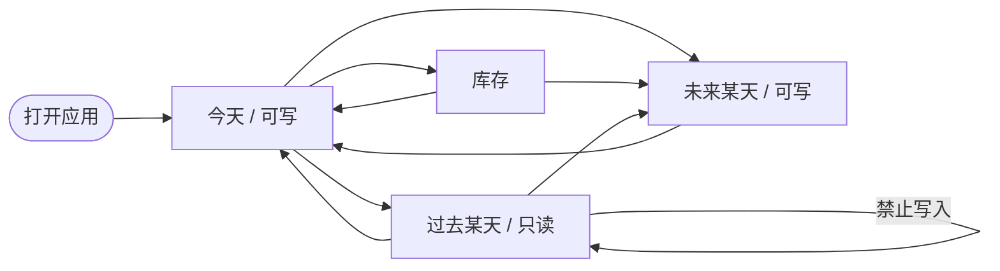
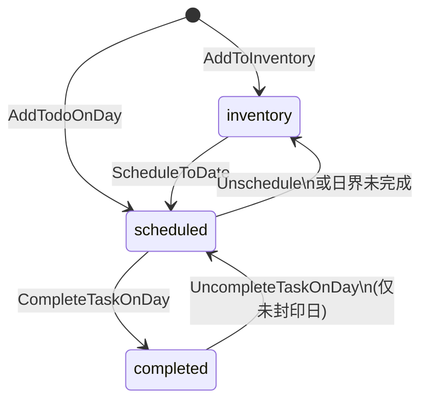
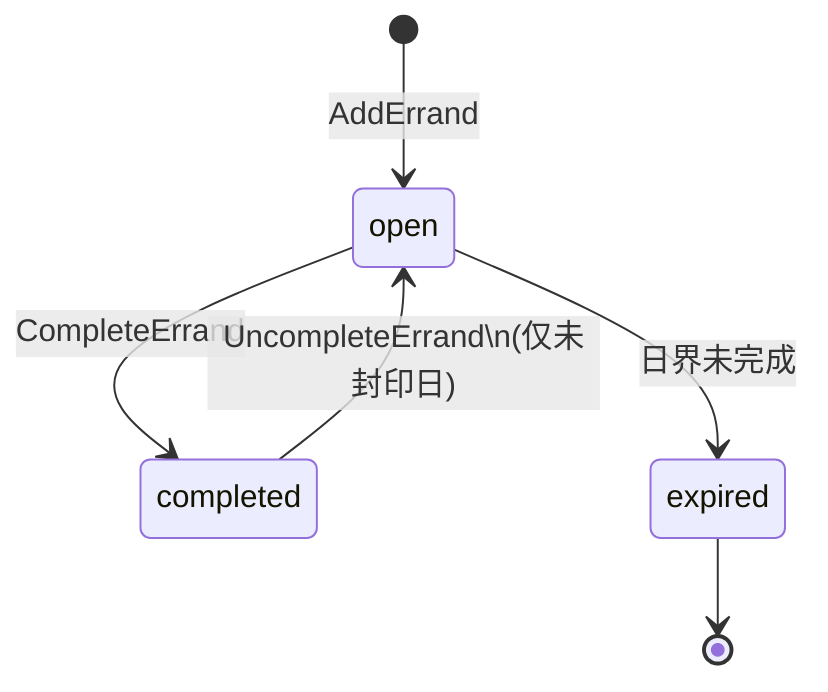
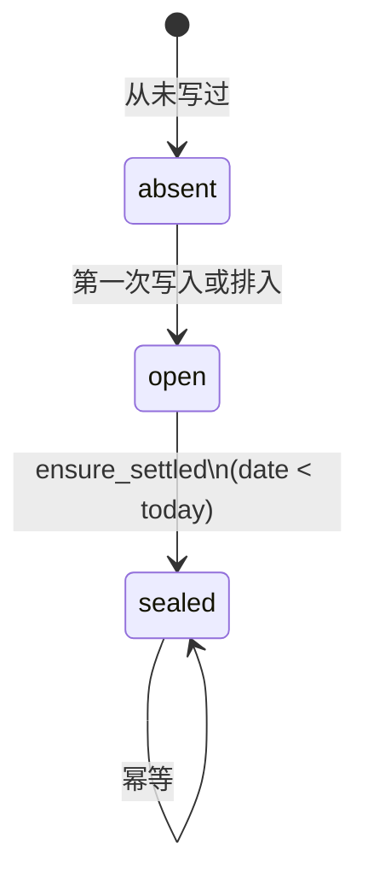
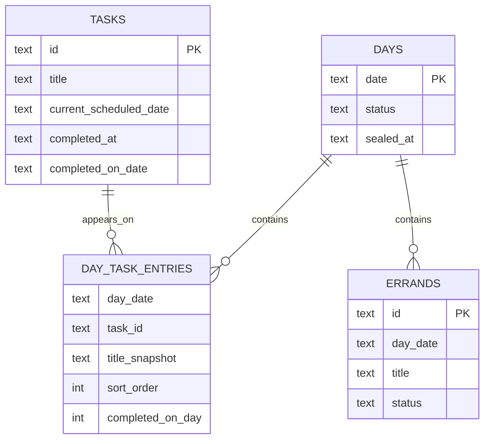
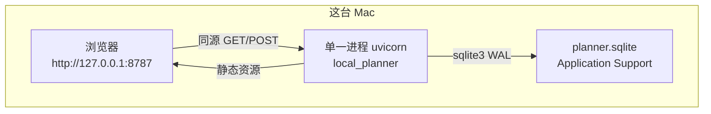
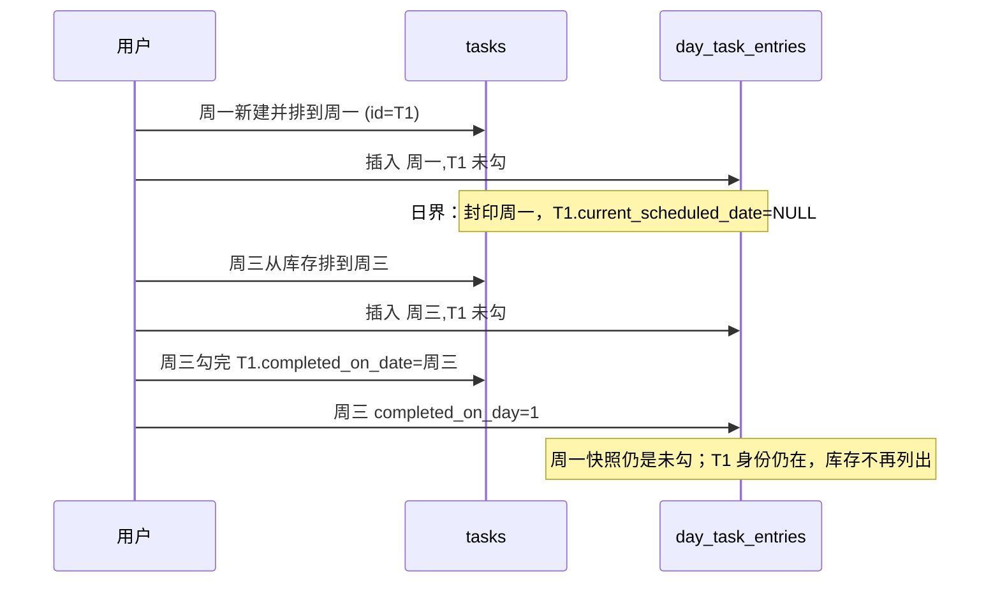
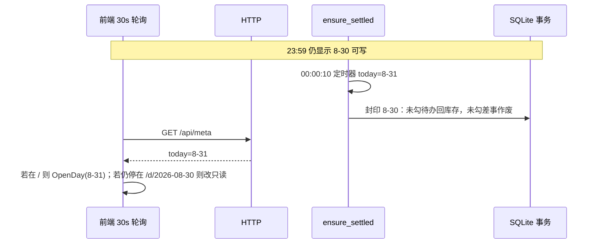

# Local Planner v1 设计文档

| 字段 | 值 |
| --- | --- |
| 文档标题 | Local Planner v1 技术设计 |
| 工作名 | Local Planner（正式名未定） |
| 作者 | TBD |
| 日期 | 2026-08-30 |
| 状态 | Draft |
| 依据 | [v1-requirements.md](../product/v1-requirements.md)、[decisions.md](../product/decisions.md) D1–D14 |
| 仓库 | `/Users/anyuchen/Projects/personal/local-planner` |
| 代码现状 | 无应用代码；不得假定已有模块 |

本文给实现者：按本文即可开工。产品范围以冻结需求为准，不引入项目树、标签、优先级、提醒、AI 排程、日历同步、全文搜索、多端、云账号。

---

## Overview

Local Planner 是跑在本机浏览器里的单人日计划工具。打开即是「今天」：正经待办与零碎差事两列清单，没有小时时间块。长期任务住在库存里，未排期的条目不得出现在今天；需要时抽到今天或指定到未来某天。同一条正经待办在完成前可跨日反复排期，身份不变。当天没做完的正经待办回到库存，不会自动堆到下一天；没做完的差事作废，仍留在那天的历史上。过去的天只读。

v1 的技术形态是：**单一本机进程**，绑定 `127.0.0.1`，同时提供静态页面和 JSON API；数据落在 **SQLite 单文件**。领域层（任务身份、日快照、日界结转）是唯一事实来源。历史不可变靠「按日封印的出现记录」实现：过去某天读快照，任务身份继续活在库存或后续某天。日历日是设计层写死的 `Asia/Shanghai` 民用日期（见下表），全程 `YYYY-MM-DD` 字符串，不是 UTC 日，也不跟随 OS 时区。

---

## Background & Motivation

当前习惯是纸质 / PDF 日计划表（日期 + To-Do List + Quick Errands；纸模右侧 06:00–23:00 小时表 **不进入 v1**）。纸张能写今天，但做不到三件事：长期任务有库存、不必每天手抄、过去某一天还能打开且不被事后改写。

发现阶段已拍板（D1–D14）的关系模型是选项 B 的最小切片：**正经待办是主身份，某一天是它的投影；差事只属于某一天**。软件相对纸张要赢的，不只是「能记长期」，还包括「过往某一天找得回来」（D8、D10、D13）。

若把「今天」做成未完成事项的无限总清单，主场景失败。若每天复制一行待办、互不相认，跨日推进（D11）失败。若未完成自动顺延到下一天，第二天会被堵住（D6）。设计必须同时保住这三条。

---

## Goals & Non-Goals

### Goals（v1 必须）

1. 打开就是今天；几分钟内写下或抽出今天的正经待办，并另列差事。
2. 库存只收未排期、未完成的正经待办；未排期条目不出现在今天。
3. 在今天直接写正经待办 = 新建并立刻排到今天（D12）。
4. 可把库存任务排到今天或未来某天；那天一到自动出现（D14）。
5. 日结束：未完成正经待办回库存；未完成差事作废并留在该日历史。不自动滚到下一天。
6. 同一 `task_id` 可出现在多天的历史上，直到勾完成才离开库存语义。
7. 按日期打开任意一天：过去只读，今天与未来可写。
8. 数据只在这台 Mac 上；关掉浏览器再打开仍在。
9. 实现者可按本文的命令接口、表结构、结转算法、测试清单落地。

### Non-Goals（v1 明确不做）

- 小时时间块、电子课程表、外部日历同步
- 手机端、macOS 独立应用、终端 UI、原生套壳
- 多设备同步、云账号、远程后端
- 项目树、标签、优先级、习惯打卡、截止日期体系
- 全文搜索历史、提醒、AI 自动排程
- 多人协作
- 改写已经封印的过去某一天
- 自动备份到网盘（v1 备份 = 复制数据文件）
- 产品正式名、分组（课业/实验室/竞赛/代码项目）

### 设计层已拍板、避免实现时再争论的边界

| 决策 | 选择 | 原因 |
| --- | --- | --- |
| 未来某天能否直接新建正经待办 | **允许** | 未来天可写；与 D12 对称，避免「必须先入库再排期」的多余步骤 |
| 差事能否写在未来某天 | **允许** | 差事属于「某一天」，不限于字面「今天」 |
| 同一任务能否同时排到多个日期 | **不可以** | v1 每天从库存抽一条线；多日期并行会破坏「当天投影」 |
| 库存是否列出已排到未来的任务 | **不列出** | 库存定义是未排期；用月历占位圆点找回「排到了哪天」 |
| 已完成任务是否还在库存 | **不在** | 「做完才从库存消失」 |
| 过去天是否显示该任务后来的完成日 | **不显示** | 历史是那天的记录，不把未来信息写回去 |
| 放弃 / 归档 | **不做** | 误建且无封印历史的可删；有历史的只能留着或做完 |
| 日历日如何算 | **写死 `Asia/Shanghai` 民用日** | 不是 UTC 日，不调用 `tzlocal()` / OS 时区。人在纽约把系统时区改掉，本应用仍在上海 00:00 结转。D1–D14 未写时区；这是设计冻结，禁止事后「修」成本机时区 |
| 未来日勾完成时 `completed_on_date` | **= 日计划日 `D`，不是「命令发生时的上海今天」** | `completed_at` 才是 UTC 瞬间。今天 8-30 勾 8-31 的待办：`completed_on_date=2026-08-31`，`completed_at` 落在 8-30 |
| HTTP 框架与 UI 库 | **FastAPI + Vite + React + TypeScript** | 不在 FastAPI/Starlette 之间摇摆；SPA 用 React（无 UI kit）。JSON 由 HTTP 适配器转 camelCase，领域保持 snake_case |

---

## Key Decisions

1. **领域层是唯一事实来源；HTTP / UI 不复制状态机。** 日界、只读、回库存、差事作废全部在领域命令里执行。前端只发命令、渲染返回值。避免两套「今天」逻辑在午夜分叉。
2. **正经待办有稳定身份（`tasks`），某一天只保存出现快照（`day_task_entries`）。** 跨日是同一 `task_id`；过去天读快照（含当时标题、当天是否勾上）。这同时满足 D11（身份连续）和 D13（历史不被事后改写）。
3. **库存不是独立实体，是查询：`completed_at IS NULL AND current_scheduled_date IS NULL`。** 不维护第二份清单，避免和排期状态漂移。
4. **日界结转是幂等事务：封印所有 `date < today` 的未封印天。** 水位 `last_settled_date`。不依赖常驻 daemon；进程关闭数天后再打开，一次性补结转。
5. **已封印的天永不解封**，即使系统时钟回拨。回拨只能让「今天」暂时变成某个已封印日——该日仍只读。这是历史不可变的硬约束。
6. **日历日固定 `Asia/Shanghai`，全程传递 `YYYY-MM-DD` 字符串。** 禁止把日期解析成 UTC 午夜的 `Date`。时间戳用 UTC ISO-8601，归属日用上海民用日。
7. **存储选 SQLite 单文件，不用 IndexedDB / 纯 JSON 作为主存储。** 结转必须原子：写历史 + 回库存 + 差事作废同一事务。备份 = 复制该文件（或 `VACUUM INTO` / `.backup`）。
8. **进程模型：一个本机 HTTP 进程，只绑 `127.0.0.1`，永不监听 `0.0.0.0`。** `uvicorn.run(..., host="127.0.0.1", workers=1, reload=False)`。README 与启动日志只写 `http://127.0.0.1:8787`；不宣传 `localhost`（macOS 上它常走 `::1`，本进程不听 IPv6）。把 bind 改成 `0.0.0.0` 视为隐私事故，不是配置技巧。无远程后端、无账号。
9. **栈：Python 3.12+（领域 + sqlite3 + FastAPI + uvicorn）+ Vite + React + TypeScript SPA。** sqlite3 在标准库；领域可脱离 HTTP 单测。PR Plan 按此栈写路径。全 TS 是「整段替换适配器」的分叉，不是混用。
10. **每个 `/api/*` 处理器（`GET /api/health` 除外）走 §4.1.1：适配器持 `PLANNER_LOCK`，`UnitOfWork.transaction()` 发唯一的 `BEGIN IMMEDIATE`，再 `ensure_settled()` 与命令。** 连接 `isolation_level=None`。领域不拿锁、不 BEGIN。前端 30s 轮询只服务 UX。午夜后若人停在 `/d/昨天`，按 §6.6 **改成只读渲染**，不整页踢回今天。
11. **过去天的标题以 `title_snapshot` 为准。** 改名只改 `tasks.title` 和未封印条目的快照。
12. **v1 无功能开关、无集群发布。** 「上线」= 本机启动成功；「回滚」= 换回上一份 SQLite 副本；「重置」= 删库重启。

---

## Proposed Design

### 1. 信息架构与屏幕

应用只有一个壳、三个主表面。没有独立「设置云同步」或「项目」页。

```
┌──────────────────────────────────────────────────────────┐
│  Local Planner                    [今天]  [库存]  [日期] │
├──────────────────────────────────────────────────────────┤
│                                                          │
│   主表面 A：某一天（默认=今天）                           │
│   主表面 B：库存                                          │
│                                                          │
└──────────────────────────────────────────────────────────┘
```

#### 1.1 路由

| 路由 | 表面 | 说明 |
| --- | --- | --- |
| `/` | 今天 | 启动默认。向 API 问 `today`，再渲染当天。不要在前端用 `new Date()` 决定「今天」 |
| `/d/:date` | 某一天 | `date` = `YYYY-MM-DD`。过去只读，今天/未来可写 |
| `/inventory` | 库存 | 未排期未完成的正经待办 |

非法日期（`2026-13-40`、非 `YYYY-MM-DD`、`date.fromisoformat` 失败）→ 前端 404 页，API `404`/`400`。只读打开任意合法民用日（含很远的未来/过去空日）。**写入**若 `|date.year - today.year| > 10` → `400 ValidationError`（死规则，不是「可拒」）。

#### 1.2 壳（所有页共用）

- 左侧：工作名。
- 中间：当前表面标题。日视图显示「2026年8月30日 星期六」，若 `date == serverToday` 加徽章「今天」；若过去加「只读」；若未来加「未来」。
- 日视图左右箭头：上一天 / 下一天（民用日 ±1）。
- 日期按钮：打开月历。月历请求 `GET /api/calendar?from=&to=`。圆点按 **entry 计数**：该日 `day_task_entries` 行数 + `errands` 行数 > 0 才打点。空的 `days` 行（全部 Unschedule 光了）不打点。点某一天跳 `/d/:date`。点「今天」回 `/`。
- 右侧：库存入口，可显示未排期数量徽章。

不在 v1：全局搜索框、通知铃、账号。

#### 1.3 日视图（今天 / 未来 / 过去共用一套布局）

继承纸模左栏，不做右栏小时表。

```
┌─────────────────────────────────────────────┐
│  ←  2026年8月30日 周六  [今天]  →     库存 │
├─────────────────────────────────────────────┤
│  正经待办                              [+]  │
│  ☐ 把设计文档写完                           │
│  ☑ 交实验记录                               │
│  ☐ 读那篇相关工作                           │
│  ┌─────────────────────────────────────┐    │
│  │ 写下一条正经待办，回车即加入今天     │    │
│  └─────────────────────────────────────┘    │
│                                             │
│  零碎差事                              [+]  │
│  ☐ 打印材料                                 │
│  ☐ 回一封短邮件                             │
└─────────────────────────────────────────────┘
```

规则：

- **正经待办**和**零碎差事**视觉分区，两个独立列表、两套命令。
- 可写日：复选框可点；底部输入框回车即 `AddTodoOnDay` / `AddErrand`；可改标题、可拖拽排序、可删除符合规则的条目。
- 只读日：无 `[+]`、无输入框；复选框禁用；标题不可改。未完成差事显示为「已作废」，不是还能勾的空框。
- 今天直接输入正经待办 = 新建任务 + 排到今天。不先跳库存。
- 可写日每条正经待办提供：「移回库存」「改排到另一天」（日期选择器，仅今天与未来）。
- 库存任务抽到这一天：在可写日的正经待办区提供「从库存添加」面板（小列表或弹出），调用 `ScheduleToDate`。
- 空状态文案：今天「写下今天要做的事，或从库存抽几条」；未来「预排这一天」；过去「这一天没有记录」。

#### 1.4 库存

```
┌─────────────────────────────────────────────┐
│  库存 · 未排期                          [+] │
├─────────────────────────────────────────────┤
│  把竞赛报名表填了                           │
│     [排到今天]  [排到某天…]                 │
│  把实验室那组数据补上                       │
│     [排到今天]  [排到某天…]                 │
│  ┌─────────────────────────────────────┐    │
│  │ 记一条还不定哪天做的事               │    │
│  └─────────────────────────────────────┘    │
└─────────────────────────────────────────────┘
```

- 只列出未完成且未排期的正经待办。已排到今天或未来的不出现。已完成的不出现。
- `[排到今天]` → `ScheduleToDate(id, today)` 后可留在库存页或跳今天。
- `[排到某天…]` → 日期选择器，禁用过去日。
- 新建只入库存，**不**出现在今天。
- 无封印历史的条目可删除；有封印历史的不可删（见命令节），避免挖空过去某天的身份。

#### 1.5 导航与「打开就是今天」

启动 / 刷新 `/` 永远以服务器 `today` 为准。用户在过去日按「今天」徽章回到 `/`。不默认打开昨天——那会直接打脸 D1。

#### 1.6 屏幕状态机



---

### 2. 领域模型与状态机

实现放在无 I/O 的领域包（建议 `src/local_planner/domain/`）。持久化与 HTTP 都是适配器。

#### 2.1 三个工作对象

| 对象 | 产品含义 | 实现对应 |
| --- | --- | --- |
| 正经待办 | 值得跨日的任务 | `Task` + 若干 `DayTaskEntry` |
| 零碎差事 | 只属于某一天 | `Errand`（无库存行） |
| 某一天 | 一张日计划 | `DayPlan`（`days` 行 + 当天两条列表） |

`DayPlan` 是聚合根的读模型，不是与 Task 平行的第二套待办库。

#### 2.2 类型（实现契约）

日期一律 `str` 形式的民用日 `YYYY-MM-DD`（由 `datetime.date.isoformat()` 产出，**禁止**对字符串做 `+1` 日算术）。时间戳一律 UTC，格式为秒级 `YYYY-MM-DDTHH:MM:SSZ`（`strftime("%Y-%m-%dT%H:%M:%SZ")` 或等价；**无毫秒、无 `+00:00` 偏移写法**，恒以字面 `Z` 结尾）。

```python
from dataclasses import dataclass
from datetime import date, timedelta
from typing import Literal, Optional

CalendarDate = str  # "2026-08-30" — Asia/Shanghai civil date
UtcInstant = str    # always "2026-08-30T16:01:00Z" (seconds, literal Z, no millis)
TaskId = str        # uuid4
ErrandId = str

TaskStatus = Literal["inventory", "scheduled", "completed"]
# 派生值，不单独落库

ErrandStatus = Literal["open", "completed", "expired"]
DayStatus = Literal["open", "sealed"]


@dataclass(frozen=True)
class Task:
    id: TaskId
    title: str
    created_at: UtcInstant
    current_scheduled_date: Optional[CalendarDate]  # None = 未排期
    completed_at: Optional[UtcInstant]
    completed_on_date: Optional[CalendarDate]


@dataclass(frozen=True)
class DayTaskEntry:
    """任务在某一天的出现快照。封印后只读。"""
    day_date: CalendarDate
    task_id: TaskId
    title_snapshot: str
    sort_order: int
    completed_on_day: bool


@dataclass(frozen=True)
class Errand:
    id: ErrandId
    day_date: CalendarDate
    title: str
    sort_order: int
    status: ErrandStatus
    completed_at: Optional[UtcInstant]


@dataclass(frozen=True)
class DayPlan:
    date: CalendarDate
    status: DayStatus
    sealed_at: Optional[UtcInstant]
    todos: list[DayTaskEntry]
    errands: list[Errand]


@dataclass(frozen=True)
class InventoryItem:
    task: Task
    # v1 不带「曾出现在哪些天」；历史只通过打开那天看
```

派生：

```python
def task_status(t: Task) -> TaskStatus:
    if t.completed_at is not None:
        return "completed"
    if t.current_scheduled_date is not None:
        return "scheduled"
    return "inventory"


def is_writable(day: DayPlan, today: CalendarDate) -> bool:
    return day.date >= today and day.status == "open"
```

`date >= today` 且 `status == "open"` 才可写。封印优先于「日历上是不是今天」：已封印永不写。

#### 2.3 不变量

1. 排期指针与开放日快照互推（实现 Complete/Uncomplete/Schedule 必须对准这三条，禁止再写「完成却仍占排期」的混合句）：
   - **(a)** `current_scheduled_date = D` ⇒ 恰好一行 `day_task_entries(D, task_id)`，且该 `days.status = 'open'`，且 `tasks.completed_at IS NULL`。
   - **(b)** `completed_at` 非空 ⇒ `current_scheduled_date IS NULL`，且 `completed_on_date = D` 的那一行 `completed_on_day = 1`。
   - **(c)** 已封印日上 `completed_on_day = 0` 的快照 **不得** 让 `current_scheduled_date` 仍指向该封印日（日界必须清掉；未完成封印快照 ≠ 当前排期）。
2. 未完成任务至多排到一个日期。
3. `completed_at` 与 `completed_on_date` 同空或同非空。`completed_on_date` 是勾选所在的 **日计划日 D**（今天或未来），不必等于 `completed_at` 换算成的上海今天。
4. 库存查询结果不得包含已排期或已完成任务。
5. `Errand` 没有 `task_id`，不出现在库存。
6. `days.status = sealed` 后，该日所有条目禁止 insert/update/delete；`days` 禁止 `sealed → open` 或改 `sealed_at`。应用层先拒绝；**schema 触发器必须兜底**（见 §3.2，不是可选项）。
7. 同一 `(day_date, task_id)` 至多一行。
8. 同一日内 `sort_order` 在 `day_task_entries` 与 `errands` 各自唯一。Reorder 在同一事务里重写该日全部序号。
9. 标题与 `title_snapshot`：去首尾空白后长度 1–200，拒绝空串。

#### 2.4 正经待办状态机



| 事件 | 前提（否则 409/400） | 效果 |
| --- | --- | --- |
| `AddToInventory` | 标题合法 | 新 Task，排期空，未完成 |
| `AddTodoOnDay(D)` | D 可写；年份帽满足 | 新 Task + `current_scheduled_date=D` + entry（`title_snapshot=title`，`completed_on_day=0`，`sort_order=max+1` 或 0） |
| `ScheduleToDate(D)` | `completed_at IS NULL`；D 可写；若已排到可写日 D1≠D，先删 D1 entry | 见 §5.3：新 entry 拷贝 `tasks.title` |
| `Unschedule` | 未完成，且 `current_scheduled_date` 指向可写日 | 删该日 entry，回库存 |
| `CompleteTaskOnDay(D)` | D 可写；存在 entry；`completed_on_day=0`；`completed_at IS NULL`；**`current_scheduled_date == D`**（不变量 1a） | entry 勾上；`completed_at=now_utc`；**`completed_on_date=D`**（可以是未来日）；清空排期（不变量 1b） |
| `UncompleteTaskOnDay(D)` | D 可写；entry `completed_on_day=1`；任务 `completed_on_date == D` 且 `completed_at` 非空 | 取消勾；任务未完成；排期回到 D（恢复 1a） |
| 日界未完成 | `settle_one_day(D)`：entry 未勾且排期仍是 D | 清空排期（不变量 1c）；entry 保留为未勾快照 |
| `seal_day(D)`（测试/领域原语，非用户命令） | 供 PR 2 在没有水位时钟时做封印拒绝测试 | 与 `settle_one_day` 相同效果；**不**读 `last_settled_date` |

完成 **不会** 删除过去未勾的快照：昨天「没做完」仍是昨天的事实。

#### 2.5 差事状态机



`expired` 只出现在已封印日，不可逆。没有库存入口，也没有跨日身份。

#### 2.6 某一天状态机



- 未写过的过去日：打开时返回空的只读 `DayPlan`（`status=sealed` 或虚拟只读），不必预先插入空行。若实现选择插入空 `sealed` 行也可以，查询必须表现一致。
- 未来日：第一次排入或手写时创建 `open` 行。
- 今天：只要还是今天，就不封印。

#### 2.7 时区

这是 **设计层冻结**（见「设计层已拍板」表），不是 D1–D14 的原文。禁止事后改成 `tzlocal()`。

- 应用时区 **写死** `Asia/Shanghai`（无 DST）。不跟 OS 时区走：人在纽约把系统改成 `America/New_York`，本产品的「今天」仍是上海日，日界仍是上海 00:00（即纽约中午）。v1 不提供时区设置。
- `today = datetime.now(ZoneInfo("Asia/Shanghai")).date().isoformat()`。`meta.timezone` 只是给 debug 看的备注，逻辑路径不得读它。
- `created_at` / `completed_at` / `sealed_at` 存 UTC，格式见 §2.2（字面 `Z`、无毫秒）。
- **`completed_on_date` = 命令目标日计划 `D`**（今天或未来可写日），**不是** `completed_at` 换算出来的上海今天。今天 8-30 在可写的 8-31 上勾完：`completed_on_date="2026-08-31"`，`completed_at` 的上海民用日是 8-30。二者可以不同。必测：冻结 2026-08-30，对 8-31 执行 Complete，断言 `completed_on_date=2026-08-31`、8-31 快照已勾、库存无此任务。
- **前端禁令：** 不要 `new Date("2026-08-30")`（那是 UTC 午夜，在西半球会变成前一天）。展示、路由、API 全部用日期字符串；需要星期几时，用无时区算法或显式 `timeZone: "Asia/Shanghai"` 的 formatter。

注入时钟，测试才能钉住午夜：

```python
class Clock:
    def now_utc(self) -> datetime: ...
    def today(self) -> CalendarDate: ...
```

生产用系统时钟；测试用 `FrozenClock("2026-08-30T16:00:00+08:00")`。

#### 2.8 身份跨日 vs 历史不可变

这是本设计的核心张力。

| 层 | 变不变 | 谁读 |
| --- | --- | --- |
| `tasks` 行 | 身份稳定；标题、完成态会变 | 库存、当前排期 |
| `day_task_entries` | 封印后不变 | 打开某一天 |

因此：

- 改名：未封印日的 entry 跟着改；已封印日仍显示当时的 `title_snapshot`。
- 某任务周一未完成、周三才勾完：周一快照仍是未勾；周三快照是已勾；库存里它已消失。
- 禁止「把过去那天的勾选改成已完成」。要看后来做没做，去完成当天或看它还在不在库存——v1 不做跨日时间线 UI。

ER 关系：



---

### 3. 持久化

#### 3.1 选择与理由

| 方案 | 优点 | 缺点 | 结论 |
| --- | --- | --- | --- |
| SQLite 单文件 | 事务、崩溃安全、单文件备份、stdlib、按日查询自然 | 需本机进程，不能纯静态托管 | **采用** |
| 按日 JSON + tasks.json | 人能读 | 结转非原子；写一半会裂；并发虽单人也怕崩溃 | 不用作主存储 |
| 浏览器 IndexedDB | 可无后端 | 备份隐蔽（Origin 数据）；结转与多页签；测试差 | 不用 |
| localStorage | 零依赖 | 配额小、无事务、无结构 | 不用 |

主库：SQLite 3，`WAL`，`foreign_keys=ON`，`busy_timeout=5000`。连接必须 `sqlite3.connect(..., isolation_level=None, check_same_thread=False)`——关掉 Python 默认的隐式 `BEGIN DEFERRED`，否则再执行 `BEGIN IMMEDIATE` 会 `cannot start a transaction within a transaction`，R13 的立即锁也拿不到。真正的 `BEGIN IMMEDIATE` / `COMMIT` / `ROLLBACK` **只允许**出现在 `UnitOfWork.transaction()` 里（见 §4.1.1）。

路径：

```
默认：~/Library/Application Support/local-planner/planner.sqlite
覆盖：环境变量 LOCAL_PLANNER_DATA_DIR（目录，文件名仍为 planner.sqlite）
开发：仓库内 .data/planner.sqlite（gitignore）
```

备份（v1 足够）：

```bash
# 进程可在运行时用 SQLite backup API；停机时可：
cp "$DATA_DIR/planner.sqlite" "$DATA_DIR/backups/planner-$(date +%Y%m%d-%H%M%S).sqlite"
# 若 WAL 正在用，优先：
sqlite3 "$DATA_DIR/planner.sqlite" ".backup '$DATA_DIR/backups/planner-....sqlite'"
```

重置：退出进程，删除 `planner.sqlite`、`planner.sqlite-wal`、`planner.sqlite-shm`，再启动。空库按 schema v1 初始化。

不在 v1：自动定时备份、iCloud 文件夹、导出 Markdown。README 写明「备份 = 复制这个文件」。

#### 3.2 Schema v1

```sql
PRAGMA foreign_keys = ON;

CREATE TABLE schema_migrations (
  version INTEGER PRIMARY KEY,
  applied_at TEXT NOT NULL
);

CREATE TABLE meta (
  key TEXT PRIMARY KEY,
  value TEXT NOT NULL
);

CREATE TABLE days (
  date TEXT PRIMARY KEY,          -- YYYY-MM-DD
  status TEXT NOT NULL CHECK (status IN ('open', 'sealed')),
  sealed_at TEXT,
  CHECK (
    (status = 'open' AND sealed_at IS NULL)
    OR (status = 'sealed' AND sealed_at IS NOT NULL)
  )
);

CREATE TABLE tasks (
  id TEXT PRIMARY KEY,
  title TEXT NOT NULL CHECK (length(title) BETWEEN 1 AND 200),
  created_at TEXT NOT NULL,
  current_scheduled_date TEXT REFERENCES days(date),
  completed_at TEXT,
  completed_on_date TEXT,
  CHECK (
    (completed_at IS NULL AND completed_on_date IS NULL)
    OR (completed_at IS NOT NULL AND completed_on_date IS NOT NULL)
  )
);

CREATE TABLE day_task_entries (
  day_date TEXT NOT NULL REFERENCES days(date),
  task_id TEXT NOT NULL REFERENCES tasks(id),
  title_snapshot TEXT NOT NULL
    CHECK (length(title_snapshot) BETWEEN 1 AND 200),
  sort_order INTEGER NOT NULL,
  completed_on_day INTEGER NOT NULL DEFAULT 0
    CHECK (completed_on_day IN (0, 1)),
  PRIMARY KEY (day_date, task_id),
  UNIQUE (day_date, sort_order)
);

CREATE TABLE errands (
  id TEXT PRIMARY KEY,
  day_date TEXT NOT NULL REFERENCES days(date),
  title TEXT NOT NULL CHECK (length(title) BETWEEN 1 AND 200),
  sort_order INTEGER NOT NULL,
  status TEXT NOT NULL CHECK (status IN ('open', 'completed', 'expired')),
  completed_at TEXT,
  UNIQUE (day_date, sort_order),
  CHECK (
    (status = 'completed' AND completed_at IS NOT NULL)
    OR (status IN ('open', 'expired') AND completed_at IS NULL)
  )
);

CREATE INDEX idx_tasks_inventory
  ON tasks (completed_at, current_scheduled_date);
CREATE INDEX idx_tasks_schedule
  ON tasks (current_scheduled_date);
CREATE INDEX idx_errands_day
  ON errands (day_date, sort_order);
CREATE INDEX idx_entries_day
  ON day_task_entries (day_date, sort_order);

-- 封印不可变：001_init.sql 必含，不是建议。应用层仍先拒绝。

CREATE TRIGGER day_task_entries_no_insert_sealed
BEFORE INSERT ON day_task_entries
BEGIN
  SELECT CASE WHEN (SELECT status FROM days WHERE date = NEW.day_date) = 'sealed'
    THEN RAISE(ABORT, 'sealed day is immutable') END;
END;

CREATE TRIGGER day_task_entries_no_update_sealed
BEFORE UPDATE ON day_task_entries
BEGIN
  SELECT CASE WHEN (SELECT status FROM days WHERE date = OLD.day_date) = 'sealed'
              OR (SELECT status FROM days WHERE date = NEW.day_date) = 'sealed'
    THEN RAISE(ABORT, 'sealed day is immutable') END;
END;

CREATE TRIGGER day_task_entries_no_delete_sealed
BEFORE DELETE ON day_task_entries
BEGIN
  SELECT CASE WHEN (SELECT status FROM days WHERE date = OLD.day_date) = 'sealed'
    THEN RAISE(ABORT, 'sealed day is immutable') END;
END;

CREATE TRIGGER errands_no_insert_sealed
BEFORE INSERT ON errands
BEGIN
  SELECT CASE WHEN (SELECT status FROM days WHERE date = NEW.day_date) = 'sealed'
    THEN RAISE(ABORT, 'sealed day is immutable') END;
END;

CREATE TRIGGER errands_no_update_sealed
BEFORE UPDATE ON errands
BEGIN
  SELECT CASE WHEN (SELECT status FROM days WHERE date = OLD.day_date) = 'sealed'
              OR (SELECT status FROM days WHERE date = NEW.day_date) = 'sealed'
    THEN RAISE(ABORT, 'sealed day is immutable') END;
END;

CREATE TRIGGER errands_no_delete_sealed
BEFORE DELETE ON errands
BEGIN
  SELECT CASE WHEN (SELECT status FROM days WHERE date = OLD.day_date) = 'sealed'
    THEN RAISE(ABORT, 'sealed day is immutable') END;
END;

CREATE TRIGGER days_no_unseal_or_mutate_sealed
BEFORE UPDATE ON days
BEGIN
  SELECT CASE WHEN OLD.status = 'sealed'
    THEN RAISE(ABORT, 'sealed day is immutable') END;
END;

CREATE TRIGGER days_no_delete_sealed
BEFORE DELETE ON days
BEGIN
  SELECT CASE WHEN OLD.status = 'sealed'
    THEN RAISE(ABORT, 'sealed day is immutable') END;
END;
```

`tasks.current_scheduled_date` 有指向 `days.date` 的 FK：同一事务里必须先插入（或确保）`days` 行，再写排期。

启动时写入（若不存在）：

```
meta.timezone = Asia/Shanghai   -- 仅 debug 展示；代码写死 ZoneInfo("Asia/Shanghai")
meta.last_settled_date = <today>  -- 仅当库被证明为空（无 days / entries / errands）
```

**不要**让迁移逻辑读 `meta.schema_version`。版本真相是 `schema_migrations`。`GET /api/debug` 的 `schemaVersion` 取 `MAX(schema_migrations.version)`。

持久化测试必须对已封印日分别尝试 INSERT/UPDATE/DELETE `day_task_entries`、`errands`，以及 `days` 的解封 / 改 `sealed_at` / DELETE，期望 SQLite ABORT。

#### 3.3 迁移与版本

- **迁移只读 `schema_migrations`**。启动时按编号执行 `src/local_planner/persistence/migrations/00N_*.sql`。
- v1 只有 `001_init.sql`（含上表全部触发器与 CHECK）。
- 迁移前用 SQLite backup API 拷一份到 `backups/pre-migrate-<version>-<timestamp>.sqlite`。失败则退出进程，不接着侍候损坏库。
- 无向下迁移。回滚 = 停进程，换回备份文件。

#### 3.4 容量（量级，用于安心而不是优化）

- 每天 ~20 条待办 + ~10 条差事；年 ~1e4 行级记录。
- 十年仍远小于 10 MB。
- 库存即使到数百条也一次读出。v1 不分页、不搜索。
- 本地 API 目标：P99 < 50 ms（含结转在无积压时）。若一次补结转 60 个有内容的天，允许首次打开到数百毫秒。**`ensure_settled` 必须在同一 `BEGIN IMMEDIATE` 内处理全部待封印日**（含水位最后写入）。禁止按日提交——否则崩溃会造成半封印。日期数少，单事务足够。

---

### 4. 本机网页架构与进程模型

没有远程后端。浏览器只打本机。



#### 4.1 进程

- 一个进程：静态 SPA + `/api/*`。
- 监听 **`127.0.0.1:8787`**。`serve` 必须调用：

```python
uvicorn.run(app, host="127.0.0.1", port=port, workers=1, reload=False)
```

  禁止 `0.0.0.0`、禁止 `--reload` 作为日常命令、禁止 `workers>1`。换端口：`LOCAL_PLANNER_PORT`。
- 启动日志与 README **只**打印 `http://127.0.0.1:{port}`。不写 `http://localhost:…`：macOS 上 `localhost` 常解析到 `::1`，本进程不听 IPv6，连接会失败。不额外绑 `::1`（少一个套接字；用户按日志里的数字地址打开即可）。
- 启动：`python -m local_planner serve`
  1. 确保数据目录存在
  2. 打开 SQLite（`isolation_level=None`），开 WAL 与 foreign_keys；`PRAGMA integrity_check`
  3. 跑迁移（只读 `schema_migrations`）
  4. 与请求同一条路径：持 `PLANNER_LOCK` → `uow.transaction()` → `ensure_settled()`（领域自己不 BEGIN、不拿锁）
  5. 若生产模式：找不到已构建的 `web/dist/index.html` 则 **拒绝启动**，stderr 写 `run npm run build`（开发可用 `LOCAL_PLANNER_DEV=1` 只开 API）
  6. 起 HTTP；后台 **线程**每 30s 走同一条「锁 → `uow.transaction()` → `ensure_settled()`」路径
- 退出：Ctrl+C / SIGTERM，关连接、关 SQLite。不留孤儿端口。
- 不需要 launchd 也能用：用时启动。可在 README 给可选的用户级 launchd plist，**不作为 v1 必达**。
- 开发：Vite `5173`，`/api` 代理到 `8787`。日常使用：一个进程同时送 `web/dist` 与 API。

#### 4.1.1 并发与事务（死规则）

stdlib `sqlite3` + FastAPI + 30s 结转 = 进程内两个写者。所有权必须分清，否则第一次请求就会 `cannot start a transaction within a transaction`，或在非可重入的 `threading.Lock` 上死锁。

**谁拥有什么（PR 3 / PR 5 不许猜）：**

| 对象 | 唯一所有者 | 禁止出现在 |
| --- | --- | --- |
| `sqlite3.connect(..., isolation_level=None, check_same_thread=False)` 以及 `PRAGMA foreign_keys=ON` / WAL / `busy_timeout` | `persistence` 打开连接时 | 领域、HTTP 路由里再 `connect` |
| `BEGIN IMMEDIATE` / `COMMIT` / `ROLLBACK` | **只** `UnitOfWork.transaction()` | `ensure_settled`、命令函数、HTTP handler 正文 |
| `PLANNER_LOCK` | HTTP 适配器与 30s 线程（及 `serve` 启动那段） | 领域包、`ensure_settled`、UoW 内部 |

`isolation_level=None` 关掉 Python 默认的隐式 `BEGIN DEFERRED`。UoW 手写立即事务：

```python
# persistence 打开连接（PR 3）
conn = sqlite3.connect(path, isolation_level=None, check_same_thread=False)
conn.execute("PRAGMA foreign_keys = ON")
conn.execute("PRAGMA journal_mode = WAL")
conn.execute("PRAGMA busy_timeout = 5000")

@contextmanager
def transaction(self) -> Iterator[None]:
    """进程内唯一的 BEGIN/COMMIT/ROLLBACK。"""
    self.conn.execute("BEGIN IMMEDIATE")
    try:
        yield
        self.conn.commit()
    except Exception:
        self.conn.rollback()
        raise
```

HTTP / 30s 线程 / 启动（PR 5）的唯一调用序：

```python
with PLANNER_LOCK:
    with uow.transaction():          # 这里才 BEGIN IMMEDIATE
        ensure_settled(clock, uow)   # 不拿锁、不 BEGIN
        today = clock.today()        # 事务内重读
        # 再读目标 days.status，然后执行命令
```

其余硬规则：

1. **`workers=1`，`reload=False`。** 第二份 worker 会再开一个 SQLite 写者。
2. 每个请求（health 除外）一把锁、一个 `uow.transaction()`：结转与命令同一事务。禁止「先结转并提交、再另开事务写命令」（R13）。
3. **路由用 FastAPI 同步 `def`。** 线程池里的 handler 仍必须获取 `PLANNER_LOCK`。
4. **一条 SQLite 连接，仅在持锁期间使用。** 不把连接借出锁外。
5. 领域（含 `ensure_settled`）只收 `Clock` + `UnitOfWork`，**看不见锁，不执行 BEGIN**。单测用内存仓或 `uow.transaction()` 包一层即可。

没有这套规则，R1/R2/R6/R13 会在「浏览器开着跨午夜」时真实发生。触发器是第二道闸，不是第一道。

#### 4.1.2 生产静态资源与 SPA fallback

浏览器路由 `/`、`/d/:date`、`/inventory` 刷新不能打到 FastAPI 404。

- 将构建产物 `web/dist` 打进包（setuptools/hatch `package-data`，或相对 `Path(__file__).resolve().parents[…]/web/dist`）。优先包内数据；开发树回退到仓库 `web/dist`。
- 挂载：`GET /api/*` 走 JSON 路由；其余 GET 先试 `dist` 下的真实文件（带 hash 的 JS/CSS）；**都不是文件则返回 `index.html` 200**。
- 未知 `/api/...` → JSON 404，不 fallback。
- 必测（PR 6）：ASGI `GET /inventory`、`GET /d/2026-08-30` 返回 HTML 200（`text/html`，body 含 SPA 根节点），不是 FastAPI `{"detail":"Not Found"}`。

#### 4.2 建议目录（尚不存在，实现时建）

```
local-planner/
  docs/product/ ...
  docs/design/v1-design.md      ← 本文件
  src/local_planner/
    __main__.py
    clock.py
    domain/                     # 纯逻辑
    persistence/
    http/
  web/                          # Vite + React + TypeScript SPA
  tests/
  pyproject.toml
  .data/                        # gitignore，开发库
```

`AGENTS.md` 在设计审查通过前禁止写应用代码。审查通过后把「当前范围」改成允许按本设计实现。

#### 4.3 前端原则

- SPA：**Vite + React + TypeScript**。无 UI kit。路由可用 `react-router` 或手写 `location.pathname`；要能处理 `/`、`/d/:date`、`/inventory`。
- HTTP JSON 为 camelCase；领域/Python 为 snake_case。**只在 HTTP 适配器转换**，不要在 React 里再造一套下划线类型。
- 应用状态以服务器为准。写接口返回受影响的 `DayPlan` 或 `InventoryItem`（HTTP 200 + body）；v1 仍可再 GET 一次，但不依赖「没 body」。乐观更新可选，不是 v1 必达。
- 「今天」只来自 `GET /api/meta` 或日视图载荷里的 `serverToday`。
- 30s 轮询 `GetMeta`。`serverToday` 变化时的 UX **冻结为 §6.6**：人在 `/` → `OpenDay(新 today)`；人停在 `/d/昨天` → **同一 URL 改只读渲染**（去掉输入框、禁用勾选），不整页踢回今天。前端轮询不替代后端结转。

---

## API / Interface Changes

全新系统，无旧 API。UI **只**通过下列用例说话。HTTP 是适配器，不是第二套规则：JSON **camelCase**，领域 **snake_case**，只在适配器转换。

**每个 `/api/*` handler（`GET /api/health` 除外）**走 §4.1.1 的调用序：`PLANNER_LOCK` → `uow.transaction()`（唯一的 `BEGIN IMMEDIATE`）→ `ensure_settled()` → 读/写。库存成员和昨天差事的 `expired` 都依赖这次结转，故 `GET /api/inventory` 与 `GET /api/calendar` 不能跳过。

写成功：**一律 HTTP 200** + 受影响资源的 JSON（日命令返回完整 `DayPlan`；库存新建返回该 `InventoryItem`；`DeleteTask` 返回 `{"ok": true}`）。不用 201/204。客户端可以少一次 GET；v1 仍允许再拉。

### 5.1 错误

领域错误映射：

| 错误 | HTTP | 何时 |
| --- | --- | --- |
| `ValidationError` | 400 | 空标题、坏日期格式、`|year - today.year| > 10` 的写入 |
| `NotFound` | 404 | 未知 task/errand。日期格式坏 → 400 `ValidationError`；格式合法的空日走 `OpenDay` 虚拟日，不 404 |
| `DaySealed` | 409 | 对 `date < today` **或** `days.status='sealed'` 的任何写入（含虚拟过去空日）。不再另设 `NotWritable` |
| `Conflict` | 409 | 已完成再排期；`current_scheduled_date != D` 却 Complete；Reorder 的 id 集合不是当天排列；重复排到同一天 |

响应体：`{"error": "<code>", "message": "<中文短句>"}`。

`GET /api/health` → `200 {"ok": true}`。不持锁结转（活性探针）。不返回路径或标题。

### 5.2 读

**`GetMeta`** — `GET /api/meta`

```json
{
  "today": "2026-08-30",
  "timezone": "Asia/Shanghai",
  "lastSettledDate": "2026-08-30",
  "inventoryCount": 4
}
```

`lastSettledDate == today` 表示所有 `date < today` 已封印。

**`OpenDay(date)`** — `GET /api/days/2026-08-30`

```json
{
  "date": "2026-08-30",
  "serverToday": "2026-08-30",
  "isToday": true,
  "isPast": false,
  "isFuture": false,
  "writable": true,
  "status": "open",
  "todos": [
    {
      "taskId": "…",
      "title": "把设计文档写完",
      "completedOnDay": false,
      "sortOrder": 0
    }
  ],
  "errands": [
    {
      "id": "…",
      "title": "打印材料",
      "status": "open",
      "sortOrder": 0
    }
  ]
}
```

未写过的日子：空列表 + `writable = (date >= today)` + `status = date < today ? "sealed" : "open"`（虚拟日不必落库）。

**`ListInventory`** — `GET /api/inventory`

```json
{
  "items": [
    {"taskId": "…", "title": "竞赛报名", "createdAt": "2026-08-20T10:00:00Z"}
  ]
}
```

排序：`created_at DESC`（新的在上，便于刚记下来就排期）。不在 v1 做自定义库存排序。

**`GetCalendar(from, to)`** — `GET /api/calendar?from=2026-08-01&to=2026-08-31`

```json
{
  "today": "2026-08-30",
  "days": [
    {"date": "2026-08-30", "todoCount": 3, "errandCount": 2}
  ]
}
```

只返回 **至少有一条** `day_task_entries` 或 `errands` 的日期（`todoCount`/`errandCount` 为行数）。空 `days` 行（条目被 Unschedule 光）不出现、不打点。月历无点 = 当天没有条目。

### 5.3 写命令（用例）

以下是 UI 与测试必须覆盖的命令。伪代码为领域签名。

#### `AddTodoOnDay(date, title)`

- HTTP：`POST /api/days/:date/todos` body `{"title"}`
- 前提：`date` 可写；年份帽；标题合法
- 效果：确保 `days(date)` 为 `open`（先插日再写 FK）；插入 `tasks`；`current_scheduled_date = date`；插入 `day_task_entries`（`title_snapshot = title`，`completed_on_day = 0`，`sort_order = max(existing)+1`，空日则 0）
- 成功 200 + 该日 `DayPlan`
- 对应 D12（今天）及未来天可写

#### `AddToInventory(title)`

- HTTP：`POST /api/inventory/tasks` body `{"title"}`
- 效果：新任务，排期空。今天列表不变。
- 成功 200 + 该 `InventoryItem`

#### `ScheduleToDate(task_id, date)`

- HTTP：`POST /api/tasks/:id/schedule` body `{"date"}`
- 前提：任务存在；`completed_at IS NULL`（否则 `Conflict`）；`date` 可写；年份帽
- 若 `current_scheduled_date == date` 且已有 entry：幂等成功，返回该日 `DayPlan`
- 若已排到另一可写日 D1：删除 D1 的 entry（D1 空了仍可留着 `days` 行）；`sort_order` 空缺允许存在，直到下次 Reorder 重写
- 若 `current_scheduled_date` 指向已封印日：数据异常（违背不变量 1c）；`Conflict` + error 日志，不改封印日
- 效果：确保目标 `days` 行 `open`；`current_scheduled_date = date`；插入 entry：`title_snapshot = tasks.title`（当前标题，不是调用方另传）、`completed_on_day = 0`、`sort_order = max(该日已有)+1` 或 0
- 从 D1 改排到 D2 与从库存新排共用这一套
- 成功 200 + 目标日 `DayPlan`
- 对应「从库存抽到今天 / 预排未来」；也可用于可写日之间改排

#### `Unschedule(task_id)`

- HTTP：`POST /api/tasks/:id/unschedule`
- 前提：未完成，且 `current_scheduled_date` 指向可写日（否则 `DaySealed` / `Conflict`）
- 效果：删该日 entry，`current_scheduled_date = NULL`（回库存）
- 成功 200 + 该 `InventoryItem`
- 产品没点名，但没有它，排错天只能等到日界。列入 v1。

#### `CompleteTaskOnDay(task_id, date)` / `UncompleteTaskOnDay(task_id, date)`

- HTTP：`POST /api/days/:date/todos/:taskId/complete` 与 `.../uncomplete`
- **Complete 前提（缺一则 409）：** `date` 可写；存在 `(date, task_id)` entry；`completed_on_day = 0`；`tasks.completed_at IS NULL`；**`tasks.current_scheduled_date == date`**。禁止靠「碰巧有第二行 entry」完成仍排在别日的任务。
- Complete 效果：`completed_on_day=1`；`completed_at=now_utc`（格式 §2.2）；**`completed_on_date=date`（日计划 D，可以是未来）**；`current_scheduled_date=NULL`。不变量 1b。
- **Uncomplete 前提：** `date` 可写；entry `completed_on_day=1`；`tasks.completed_on_date == date` 且 `completed_at` 非空。
- Uncomplete 效果：`completed_on_day=0`；`completed_at`/`completed_on_date` 清空；`current_scheduled_date=date`。不变量 1a。
- 禁止对过去日 / 封印日补勾（`DaySealed`，D13）
- 成功 200 + 该日 `DayPlan`

#### `AddErrand(date, title)` / `CompleteErrand` / `UncompleteErrand` / `DeleteErrand` / `RenameErrand`

路径里带 `date` 的（`AddErrand`、`ReorderErrands`）直接用该日做闸门。路径只有 `:id` 的（complete / uncomplete / delete / rename）**必须先解析 id → `errands.day_date`，再走与 `AddErrand` 完全相同的可写闸门**，禁止「按 id UPDATE、靠触发器变 500」。

共用闸门 `require_writable_day(D)`（缺一则失败，不要落到触发器）：

1. 存在差事行，否则 `404 NotFound`
2. `D = errands.day_date`（或 Add 的路径参数）
3. `|D.year - today.year| > 10` → `400 ValidationError`（与待办写入同一顶）
4. `D < today` 或该日 `status='sealed'`（虚拟过去空日视为封印）→ `409 DaySealed`

然后：

- `POST /api/days/:date/errands` → 闸门过了之后插入；`sort_order = max+1` 或 0；`status=open`；`completed_at NULL`；200 + `DayPlan`
- `POST /api/errands/:id/complete`：闸门 + `status='open'`（否则 `409 Conflict`）；写 `completed_at`；200 + `DayPlan`
- `POST /api/errands/:id/uncomplete`：闸门 + `status='completed'`。**`expired` 不可逆 → `409 Conflict`**，不是触发器崩溃，也不是悄悄改回 `open`
- `DELETE /api/errands/:id`：闸门 + `status in ('open','completed')`；封印日已在闸门变成 `DaySealed`（含作废项）；200 + `DayPlan`
- `PATCH /api/errands/:id` `{"title"}`：闸门 + 标题合法；200 + `DayPlan`
- 差事不进库存；无 `Schedule`。

#### `RenameTask(task_id, title)`

- `PATCH /api/tasks/:id` `{"title"}`
- 更新 `tasks.title`；同步更新所有 **未封印** 日该任务的 `title_snapshot`
- 已封印快照不动
- 成功 200 + 若当前有排期则该日 `DayPlan`，否则该 `InventoryItem`

#### `DeleteTask(task_id)`

- `DELETE /api/tasks/:id`
- 仅当 **不存在** 指向该任务的、位于 `sealed` 日的 entry
- 同时删除未封印日的 entry
- 有封印历史 → 409 `Conflict`，中文说明「过去的某一天还记着它，不能删」
- 成功 200 `{"ok": true}`

#### `ReorderTodos(date, task_ids)` / `ReorderErrands(date, errand_ids)`

- `PUT /api/days/:date/todos/order` `{"taskIds": [...]}`（差事为 `errandIds`）
- 必须是该日当前 id 集合的排列（集合相等，顺序为新序）。否则 `Conflict`
- 可写日 only。同一事务里重写全部 `sort_order` 为 `0..n-1`。SQLite 的 UNIQUE **不可 DEFERRABLE**：先写到不冲突的临时值（例如 `i + 100000`）再压回 `0..n-1`，或删后重插，禁止两条 UPDATE 在中途撞号。
- 成功 200 + `DayPlan`

#### `SettleDays`（内部，无公开「手动结转」按钮）

- 由 `ensure_settled` 调用。见下一节。
- 可不暴露 HTTP；`POST /api/internal/settle` 仅在调试开关打开时可用。

### 5.4 谁调用什么（UI 对照）

| UI 动作 | 命令 |
| --- | --- |
| 打开应用 / 点「今天」 | `GetMeta` + `OpenDay(today)` |
| 左右箭头、月历点日期 | `OpenDay(date)` |
| 今天输入框回车 | `AddTodoOnDay(today, title)` |
| 未来日输入框回车 | `AddTodoOnDay(thatDate, title)` |
| 库存输入框回车 | `AddToInventory(title)` |
| 库存「排到今天」 | `ScheduleToDate(id, today)` |
| 库存「排到某天」 | `ScheduleToDate(id, date)` |
| 勾 / 取消勾正经待办 | `Complete` / `Uncomplete` |
| 移回库存 | `Unschedule` |
| 可写日改排到另一天 | `ScheduleToDate(id, newDate)` |
| 改标题（待办 / 差事） | `RenameTask` / `RenameErrand` |
| 删除无封印历史的待办 / 可写日差事 | `DeleteTask` / `DeleteErrand` |
| 拖拽或上下排序 | `ReorderTodos` / `ReorderErrands` |
| 写差事 / 勾差事 | `AddErrand` / `CompleteErrand` |
| 隔夜仍开着 | 前端按 §6.6；后端锁内定时 `ensure_settled` |

---

## Data Model Changes

全新库，无线上迁移包袱。见 §3.2。补充读写语义：

### 打开某一天的读路径

1. `ensure_settled()`
2. 读 `days`、`day_task_entries`（按 `sort_order`）、`errands`
3. 标题用 `title_snapshot`，不用 `tasks.title`（保证过去日稳定）
4. `writable = (date >= today AND status != 'sealed')`；无行的过去日 `writable=false`

### 库存读路径

```sql
SELECT * FROM tasks
WHERE completed_at IS NULL
  AND current_scheduled_date IS NULL
ORDER BY created_at DESC;
```

### 历史不可变 vs 身份继续



同一 `task_id` 在多天出现；封印行不更新。

---

## 6. 日界 / 日结束行为

这是正确性风险最高的子系统。必须单测 + API 测钉死。

### 6.1 何时跑

| 触发 | 行为 |
| --- | --- |
| 进程启动 | 持锁 + `BEGIN IMMEDIATE` + `ensure_settled()` |
| 每个 `/api/*`（health 除外） | 同一把锁、同一事务里先结转再读/写 |
| 进程内每 30s | 后台线程拿同一把锁；覆盖「服务开着跨午夜、用户不点」 |
| 前端每 30s 拉 `GetMeta` | 只服务 UX：按 §6.6 切只读或换今天。**不**承担正确性 |

**不**做：独立后台 daemon、launchd 午夜任务、关浏览器仍跑的结转。用户连续几天不打开：下次打开一次补结转。这符合「本机用时启动」。

上海 00:00 是日界。无 DST，无 23:00–01:00 重叠。

### 6.2 算法

水位语义（实现必须写进测试名）：

- **`last_settled_date = T` 表示：所有日历日 `d < T` 均已封印（无 `days` 行的空日视为已处理，不必插行）。**
- 首次启动：`last_settled_date = today`，不回溯封印安装前的空日子。
- 已追上：`last_settled_date == today`。
- 跨过午夜：`today` 变为 T+1，封印区间为 **左闭右开 `[last, today)`**，即昨天以及任何缺口日。
- 时钟回拨导致 `last >= today`：直接返回，**不解封、不回拨水位**。

日期迭代必须走 `datetime.date`，禁止对 `"YYYY-MM-DD"` 字符串做 `+1` 或切片改日（跨月/跨年会错）：

```python
def inclusive_range(start: CalendarDate, end: CalendarDate) -> list[CalendarDate]:
    s = date.fromisoformat(start)
    e = date.fromisoformat(end)
    out: list[CalendarDate] = []
    d = s
    while d <= e:
        out.append(d.isoformat())
        d += timedelta(days=1)
    return out

def day_before(d: CalendarDate) -> CalendarDate:
    return (date.fromisoformat(d) - timedelta(days=1)).isoformat()


def earliest_relevant_date(uow: UnitOfWork) -> CalendarDate | None:
    """min(days.date, entries, errands, tasks.current_scheduled_date)."""
    ...


def ensure_settled(clock: Clock, uow: UnitOfWork) -> None:
    """纯领域：不拿 PLANNER_LOCK，不 BEGIN。调用方必须已在 uow.transaction() 内。"""
    today = clock.today()  # 事务内再读一次，见 §4.1.1
    last = uow.meta.get("last_settled_date")
    if last is None:
        if uow.is_proven_empty():
            # 无 days / day_task_entries / errands 行：真正的空库
            uow.meta.set("last_settled_date", today)
            return
        # 备份恢复、meta 丢失、测试先插日后写 meta：不得把水位直接跳到 today
        earliest = earliest_relevant_date(uow)
        if earliest is None or earliest >= today:
            uow.meta.set("last_settled_date", today)
            return
        last = earliest
    if last >= today:
        return
    # [last, today)：last=8-30 且 today=8-31 → 封印 8-30
    for d in inclusive_range(last, day_before(today)):
        settle_one_day(d, clock.now_utc(), uow)
    uow.meta.set("last_settled_date", today)
```

必测名字：`test_restore_missing_watermark_seals_existing_open_days`（有 `open` 的昨天、`last_settled_date` 缺失 → 封印昨天并回库存，水位变成 today）。

`settle_one_day(d, now, uow)`：

1. 若无 `days` 行：无需插入空日（打开过去空日走虚拟只读）。直接返回。
2. 若已 `sealed`：返回（幂等）。
3. 对该日每个 `day_task_entries`：
   - 若 `completed_on_day = 0`：取 task；若 `task.completed_at IS NULL` 且 `task.current_scheduled_date == d`，则设 `current_scheduled_date = NULL`（回库存）。entry **原样保留**。
   - 若 `completed_on_day = 1`：不改 task（应已是完成态）。若数据异常未完成，打 error 日志，仍不改封印策略：以快照为准，不在结转里「补完成」。
4. 对该日每个 `status='open'` 的 errand：`status='expired'`。已 `completed` 的不动。
5. `days.status='sealed'`，`sealed_at=now`。

全过程同一事务。崩溃则整段回滚，水位不变，下次重做。

### 6.3 历史写什么、库存写什么

| 对象 | 日界时 | 历史（该日） | 库存 |
| --- | --- | --- | --- |
| 已勾正经待办 | 封印 | 仍显示已勾 | 不出现（已完成） |
| 未勾正经待办 | 清排期 | 仍显示未勾 | **进入**（同一 task_id） |
| 已勾差事 | 不动 | 已勾 | 无 |
| 未勾差事 | `expired` | 作废可见 | 无 |
| 预排在「明天」的待办 | 不碰（明天还不是过去） | — | 不在库存，等明天成为今天时出现在当天 |
| 预排在「昨天」但用户没打开过 | 昨天被补封印，未勾则回库存 | 昨天有未勾快照 | 进入 |

「第二天是干净的」：今天的 `OpenDay(today)` 不含昨日未完成项，除非用户重新排过来。

### 6.4 连续多日未打开

例：周五排了下周一的任务，周末完全不开应用，下周二才打开。

- 补封印：周五、周六、周日、周一。
- 周一的预排任务未勾 → 回库存。
- 周二干净，库存里能再抽。
- 不会把周一的未完成自动铺到周二。

### 6.5 时钟回拨

- 已封印日不解封。
- 若 OS 时钟回到已封印日：`clock.today()` 可能 < `last_settled_date`。`ensure_settled` 在 `last >= today` 时 **no-op**。该日 API 仍只读。
- 不支持「把今天假装成上周」来补勾。这是 D13 的技术落实。

### 6.6 进程开着跨午夜（序列）



---

## Alternatives Considered

### A. 存储：按日 JSON 文档（每天一篇，类似电子纸）

每天一个文件，任务身份用文件内嵌 ID。备份直观。

- 优点：人能 diff；模型像纸。
- 缺点：结转要改「昨天文件 + 库存文件」，非原子；崩溃会双丢或双份；跨日身份要自己做索引。
- **不用。** 历史不可变 + 身份连续 + 日界原子，SQLite 更合适。JSON 导出可后置。

### B. 无本机进程：纯静态页 + IndexedDB

- 优点：双击 HTML 或 `python -m http.server` 即可；无 Python API。
- 缺点：备份在浏览器配置里，不符合「复制数据文件」；日界与多页签；领域逻辑容易堆进 React；测试和封印约束弱。
- **不用。** D7「数据在这台电脑上」要的是用户找得到的文件，不是 Origin 存储。

### C. 日计划整页深拷贝，不做 Task 身份表

每天复制标题行。完成/未完成只存在那天。

- 优点：历史天生不可变。
- 缺点：违反 D11「始终是同一条」；库存只能靠标题模糊匹配；改名、完成态无法统一。
- **不用。** 这是发现简报选项 A/F，已被 D3/D11 否决。

### D. 未完成自动滚到下一天（传统 todoist/纸质抄写）

- 优点：不会「看不见昨天欠的」。
- 缺点：直接违反 D6「第二天是干净的」。
- **不用。**

### E. 全 TypeScript（Node + better-sqlite3）

- 优点：端到端一种语言，共享类型。
- 缺点：better-sqlite3 要编 native；本机个人工具更看重「Python 标准库就能开 SQLite」。
- **作为备选分叉，不是混用。** 不变量、schema、测试名单不变。若走这条路，**整段替换 PR 1–5 的路径**（包名、HTTP 框架、SQLite 驱动），PR Plan 正文假定 Python 栈。禁止 Python 领域 + Node 写库并行存在。

### F. 库存作为独立表 vs 查询（KD3）

- 独立 `inventory` 表：每次排期/结转要双写，必漂。
- **采用查询** `completed_at IS NULL AND current_scheduled_date IS NULL`。多一次 SELECT，换不变量单一。

### G. OS 时区 / `tzlocal()` vs 写死上海（KD6）

- 跟 OS：出差改系统时区会把「今天」挪走，昨天可能尚未封印或被错封。
- **写死 `Asia/Shanghai`。** 旅行时日界仍是中国午夜（纽约中午），这是有意的，见设计层表。

### H. launchd / 午夜 daemon vs 打开时结转（KD4）

- daemon：关浏览器也能准时封印，但多一个常驻进程，v1 不需要。
- **采用打开时 + 请求时 + 进程内 30s。** 多日未打开则下次打开补结转。

---

## Security & Privacy Considerations

单用户、本机、无账号。威胁模型很小，但仍要守住「数据不离机」。

| 威胁 | 严重度 | 缓解 |
| --- | --- | --- |
| 局域网他人访问 HTTP 读计划 | 中 | 只绑 `127.0.0.1`。把 bind 改成 `0.0.0.0` 是隐私事故，不是配置技巧；`GET /api/debug` 含 `dbPath`，仅在 loopback 下可接受 |
| 浏览器扩展读页面 | 低–中 | 本机信任边界；无云泄漏。不嵌入第三方脚本、无分析 SDK |
| 依赖供应链 | 低 | 依赖尽量少：FastAPI、uvicorn、React 构建链。领域零第三方 |
| 路径穿越读数据目录以外 | 低 | API 不接收文件路径；日期严格匹配 `^\d{4}-\d{2}-\d{2}$` 且 `date.fromisoformat` 成功 |
| CSRF 从恶意网页打 loopback | 中 | 无 cookie、无 SameSite 可谈。突变方法（POST/PATCH/PUT/DELETE）**必须**校验 `Origin`：允许列表 = `http://127.0.0.1:{port}`；`LOCAL_PLANNER_DEV=1` 时另加 `http://127.0.0.1:5173` 与 `http://localhost:5173`（Vite）。**空 Origin 仅允许非浏览器客户端**（curl/httpx）。浏览器 POST 必带 Origin，不在名单则 403。只接受 `Content-Type: application/json`。CORS 关闭，永不 `Access-Control-Allow-Origin: *` |
| 把库放到会同步的 iCloud 桌面 | 低（产品） | 默认 Application Support；README 说明 v1 不同步 |
| 日志里写待办标题 | 低 | 默认 info 日志只写 id 与计数；debug 才写标题 |

无认证：能在这台 Mac 上打开浏览器的人即使用者。不为 v1 加口令。

数据永不上传。无遥测。异常不发到任何 URL。

CSP：`default-src 'self'`。开发代理例外写在 Vite 配置，不带进生产静态。

---

## Observability

无指标集群、无告警通道。本机可调试即可。

### 日志

- stderr + 可选文件 `$DATA_DIR/local-planner.log`
- 级别：`LOCAL_PLANNER_LOG=INFO|DEBUG`
- 必须出现的事件（结构化，一行 JSON 或键值）：
  - `startup data_dir=… db=… today=… last_settled=…`
  - `settled from=2026-08-30 to=2026-08-31 days=1 returned_todos=3 expired_errands=2`
  - `http method=POST path=/api/tasks/…/schedule status=200 ms=4`
  - 拒绝写封印日：`reject code=DaySealed date=…`
- 默认不打标题正文。

### 调试读口

`GET /api/debug`（仅本机，无敏感云凭证）：

```json
{
  "today": "2026-08-30",
  "timezone": "Asia/Shanghai",
  "lastSettledDate": "2026-08-30",
  "dbPath": "/Users/…/planner.sqlite",
  "schemaVersion": 1,
  "integrityCheck": "ok",
  "counts": {"tasks": 12, "openDays": 2, "sealedDays": 5, "errands": 9}
}
```

`schemaVersion` 来自 `MAX(schema_migrations.version)`，不读 `meta`。启动时 `PRAGMA integrity_check`，非 `ok` 则拒绝启动并打印路径。`dbPath` 仅因 loopback 才可接受；若有人改听 `0.0.0.0`，这就是把家目录路径暴露到局域网。

### 如何调试日界

1. 看日志 `settled …`
2. `GET /api/debug` 看水位
3. 测试用 `LOCAL_PLANNER_CLOCK=2026-08-31T00:05:00+08:00`（仅开发）冻结时钟——生产不读这个变量，除非 `LOCAL_PLANNER_ALLOW_CLOCK_OVERRIDE=1`，避免误把真数据结转进「假明天」。

---

## Rollout Plan

无功能开关、无分阶段集群。换成单机可执行的运行 / 回滚 / 重置。

### 如何运行

```bash
cd /Users/anyuchen/Projects/personal/local-planner
python3.12 -m venv .venv
source .venv/bin/activate
pip install -e ".[dev]"
python -m local_planner serve
# 只打开启动日志里的 http://127.0.0.1:8787
# 不要用 http://localhost:8787（macOS 可能走到 ::1，本进程不听）
```

生产 `serve` 需要已构建的 `web/dist`（`cd web && npm ci && npm run build`）。缺 `index.html` 则启动失败。

开发 UI：`LOCAL_PLANNER_DEV=1 python -m local_planner serve`（可无 dist）+ 另终 `cd web && npm i && npm run dev`，Vite 把 `/api` 代理到 `8787`。

### 如何备份

复制 `planner.sqlite`（WAL 模式下用 `.backup` / 应用内 backup API）。放到自己选的盘；v1 不自动做。

### 如何重置

停进程，删 `planner.sqlite*`，再 `serve`。得到空今天。

### 如何回滚一次坏迁移

停进程，把 `backups/pre-migrate-…sqlite` 拷回 `planner.sqlite`，删 `-wal/-shm`，用旧代码启动。

### 「发布」标准（个人 v1 可用）

- `pytest` 全过，含午夜、跨多日未打开、封印后写 409
- `PRAGMA integrity_check` ok
- 浏览器手点：写今天、入库、排未来、勾选、关浏览器再开、看昨天只读

---

## Testing Strategy

领域测试不启 HTTP、不摸真实时钟。持久化测试用临时文件 SQLite。API 测试用 ASGI 客户端。

### 必须自动化的例子

1. **D12** 今天写下正经待办 → 库存不含它；当天列表含它。
2. **仅入库** → `OpenDay(today)` 不含它。
3. **排到今天** → 库存消失，今天出现，同一 `task_id`。
4. **排到未来 F** → 今天不含；`OpenDay(F)` 含；`today` 变成 F 后自动含。
5. **日界未勾待办** → 昨天快照未勾；库存出现同一 id；新今天不含。
6. **日界已勾待办** → 不回库存；昨天已勾。
7. **日界未勾差事** → `expired`；库存仍无差事。
8. **差事已勾** → 仍 completed，不是 expired。
9. **跨日身份** 同一 id 出现在 D1 未勾快照与 D3 已勾快照。
10. **过去日写** 全部 409：勾选、加待办、加差事、改名 entry、删除、排序。
11. **未来日可写** 新建、勾选、改排。
12. **改名** 已封印日标题不变；库存与未封印日变。
13. **完成后再 Uncomplete（仍是今天）** 回可写今天；若随后日界仍未勾，回库存。
14. **午夜边界** 冻结 23:59+08 写一条；拨到 00:01+08；ensure_settled；旧日封印。
15. **UTC 日与上海日不一致** 冻结 `2026-08-30T16:30:00Z`（上海 8-31 00:30）→ `today=2026-08-31`。
16. **跳过 3 天** 预排在中间那天，三天后打开，中间那天封印、任务回库存、今天干净。
17. **幂等结转** `ensure_settled` 连开两次，水位与行数不变。
18. **结转中崩溃** 事务中途 raise，水位停在旧值，数据无半封印（可用测试替身仓储模拟）。
19. **时钟回拨** 封印后 today 回到昨天，写昨天仍 409。
20. **同任务同时两天** 尝试插入第二行排期，拒绝。
21. **删除** 无历史可删；有封印历史 409。
22. **标题** 空、纯空格、201 字 → 400。
23. **前端契约（可选 e2e）** Playwright：打开 `/` 看见服务器日期；不出现库存未排期项。
24. **Unschedule** 可写日移回库存；今天列表消失；库存出现同一 id。
25. **可写日 D1→D2 改排** `ScheduleToDate`：D1 无 entry，D2 有，`title_snapshot = tasks.title`，`sort_order` 为 D2 的 max+1。
26. **未来日完成** 冻结 2026-08-30，Complete 在 8-31：`completed_on_date=2026-08-31`，8-31 快照已勾，库存空，`completed_at` 的上海日是 8-30。
27. **GetCalendar** 有条目的日出现；Unschedule 光之后该日不再打点（即使 `days` 行还在）。
28. **Reorder 排列不匹配** id 集合多/少/重复 → 409。
29. **首次空库水位** `last_settled_date == today`，不伪造安装前的封印空日。
30. **虚拟空过去日** `OpenDay(昨天)` 无行：空列表、`writable=false`、读成功；写入 409 `DaySealed`。
31. **serve 只绑 127.0.0.1** 测试或启动日志断言 `host=="127.0.0.1"` 且 `workers==1`；不得出现 `0.0.0.0`。
32. **恢复路径缺水位** 见 §6.2 测试名：已有 open 昨天、meta 无 `last_settled_date` → 必须封印，不得跳过。
33. **SPA fallback** ASGI GET `/inventory` 与 `/d/2026-08-30` → HTML 200。
34. **Origin** 突变请求带恶意 Origin → 403；空 Origin 的测试客户端允许。
35. **封印触发器** 直接 SQL 改已封印 entry / 解封 `days` → ABORT。
36. **差事按 id** 对封印日 complete/rename/delete → 409 `DaySealed`（不是 500）；对 `expired` uncomplete → 409 `Conflict`。

建议布局：

```
tests/domain/test_task_state.py
tests/domain/test_settlement.py
tests/domain/test_timezone.py
tests/persistence/test_schema.py
tests/persistence/test_sealed_triggers.py
tests/http/test_days_api.py
tests/http/test_inventory_api.py
tests/http/test_sealed_rejects.py
tests/http/test_spa_fallback.py
tests/http/test_bind_and_origin.py
```

### 附录：手动回归（PR 10 合并前做一次）

不必自动化像素。实现者按序点：

1. `npm run build` 后 `python -m local_planner serve`，用 **`http://127.0.0.1:8787`** 打开（不要 localhost）。
2. 看见服务器给出的今天日期；写下一条正经待办。
3. 勾上、取消勾、改错字标题、删掉一条误建的待办。
4. 写两条差事，勾一条。
5. 库存新建一条；确认今天列表没有它。
6. 库存「排到今天」；今天出现同一件事；库存不再列出。
7. 「移回库存」，再「排到」一个未来日期。
8. 打开那个未来日，看见任务；可勾选。
9. 月历：今天/未来有圆点；乱点一个空白过去日，只读空状态。
10. 打开昨天（或冻结时钟后的昨天）：无输入框，勾选禁用。
11. 冻结时钟跨过午夜（或改 `LOCAL_PLANNER_CLOCK` 且 `ALLOW_CLOCK_OVERRIDE=1` 于**副本库**）：昨天变只读，未勾待办出现在库存，未勾差事作废，新今天干净。
12. 停进程再开：数据还在。
13. `python -m local_planner backup`（或 `.backup`），确认多出一个 sqlite 文件。
14. 用错误 Origin 的浏览器插件不必测；curl 无 Origin 的 POST 应成功。
15. 关掉进程。不把 bind 改成 `0.0.0.0`。

---

## Risks

| ID | 风险 | 严重度 | 缓解 |
| --- | --- | --- | --- |
| R1 | 浏览器跨午夜仍显示可写的「昨天」 | 高 | 锁内定时结转；同一事务重读 today；前端按 §6.6 切只读 |
| R2 | 结转写一半：历史在、库存不在或相反 | 高 | `BEGIN IMMEDIATE` 单事务；水位最后写；崩溃重做 |
| R3 | 把 `YYYY-MM-DD` 当 UTC Date 解析，西半球/晚间错日 | 高 | 全程字符串；测试钉 `16:30Z` |
| R4 | 改名/完成改写了过去天的观感 | 高 | `title_snapshot` + `completed_on_day`；过去读快照；触发器兜底 |
| R5 | 预排未来的任务在用户多日未打开后「失踪」 | 中 | 它们回库存，不丢；月历按 entry 计数打点 |
| R6 | 同一任务被排到两天（竞态或 timer 交叉） | 中 | UNIQUE(day,task) + 单排期 + `PLANNER_LOCK` + `BEGIN IMMEDIATE` |
| R7 | 时钟回拨解封历史 | 高 | 封印不可逆（触发器禁 `sealed→open`）；`last >= today` 不回滚水位 |
| R8 | 绑 `0.0.0.0` 导致局域网泄露 | 中 | 代码写死 `127.0.0.1`；改 bind 当隐私事故 |
| R9 | WAL 文件未备份，只拷了主文件 | 中 | 文档要求 `.backup`；PR 10 提供 `local-planner backup` |
| R10 | 库存找不到「已排到周四」的任务 | 中 | 月历圆点；文档说明库存=未排期。不做搜索 |
| R11 | 未来日勾完时两个「完成日」被揉成一个字段 | 中 | `completed_on_date=D`（日计划）；`completed_at` 为 UTC 瞬间；二者可比对但不必相等 |
| R12 | 首次实现把领域逻辑写进 React | 中 | PR 顺序：领域+测试先于 UI；审查拒绝 UI 内结转 |
| R13 | 请求在 23:59 结转 no-op 后跨午夜写入 | 高 | 结转与命令同一事务；mutate 前重读 today 与 `days.status` |

---

## Open Questions

产品范围已冻结。下列不挡 v1 开工；实现时按「设计层已拍板」表执行，需要改再回来改本文。

1. 产品正式名（显示在壳上的字符串，先用 Local Planner）。
2. 日视图「从库存添加」是内嵌面板还是路由跳库存（建议：今天页内嵌前 N 条 + 链到库存，不新增需求）。
3. 库存超过 200 条时的浏览体验（v1 仍全量列表）。
4. 实现者若坚持全 TS 栈：那是替换 PR 1–5 适配器的分叉（见备选 E），不是与 Python 混用。schema 与不变量不变。

`python -m local_planner backup` **已定进 v1**（PR 10 + 手动回归第 13 步），不再当作开放问题。

不在这里重新打开已关闭的 D1–D14。

---

## References

- [docs/product/v1-requirements.md](../product/v1-requirements.md) — v1 冻结需求
- [docs/product/decisions.md](../product/decisions.md) — D1–D14
- [docs/product/open-questions.md](../product/open-questions.md) — 已关闭项与后置项
- [docs/product/discovery-brief.md](../product/discovery-brief.md) — 归档发现简报；关系选项 B 已落入 D3
- [docs/product/known-context.md](../product/known-context.md) — 纸模线索
- [AGENTS.md](../../AGENTS.md) — 设计审查通过前禁止应用代码
- SQLite backup：https://www.sqlite.org/backup.html
- IANA `Asia/Shanghai`（无 DST）

---

## PR Plan

增量、每 PR 可独立审查合并。**工程顺序仍是领域 → SQLite → 水位结转 → HTTP → UI**（禁止第一个 PR 铺页面）。UI 顺序按产品切：今天待办（含改名删除）→ 差事（D5/D9）→ 按日导航/只读（D10/D13）→ 库存与排到未来（D14 的 UI 必须能点开未来日）→ 排序与 backup。

本 PR Plan **假定 Python + FastAPI 栈**。全 TS 是替换 PR 1–5 路径的分叉，不是混用。

未审查通过设计前仍不写应用代码；下列从审查通过后起算。UI PR 不要改领域不变量。

---

### PR 1 — 仓库脚手架（无产品逻辑）

- **标题：** `chore: Python 包、测试与数据目录脚手架`
- **影响：** `pyproject.toml`、`src/local_planner/__init__.py`、`src/local_planner/__main__.py`（只打印「未实现」或 `--help`）、`tests/` 占位、`.gitignore`（`.venv`、`.data/`、`node_modules`、`web/dist`）、`README.md` 运行预告、可选更新 `AGENTS.md` 允许按设计实现
- **依赖：** 无（设计已合并）
- **说明：** 能 `pip install -e ".[dev]"` 与 `pytest` 空通过。不建表、不结转。

---

### PR 2 — 时钟与领域模型（内存）

- **标题：** `feat: 领域模型、命令与 Asia/Shanghai 时钟`
- **影响：** `src/local_planner/clock.py`、`src/local_planner/domain/`（models、commands、errors、**`seal_day`**）、`tests/domain/test_task_state.py`、`tests/domain/test_timezone.py`
- **依赖：** PR 1
- **说明：** 内存仓储实现全部用户命令。覆盖 D12、库存隔离、单排期、Complete 前提（含 `current_scheduled_date == D`）、未来日完成（`completed_on_date=D`）、Unschedule、D1→D2 改排、改名/删除规则、标题校验。**封印拒绝测试调用显式 `seal_day(d)`**（效果与 `settle_one_day` 相同：回库存、差事作废、标记 sealed）。**本 PR 不实现水位时钟 `ensure_settled`。** 不引入 FastAPI、不引入前端。

---

### PR 3 — SQLite schema 与仓储

- **标题：** `feat: SQLite schema v1 与仓储`
- **影响：** `src/local_planner/persistence/`（`migrations/001_init.sql` 含 **全部** 封印触发器与 CHECK、连接 `isolation_level=None`、**`UnitOfWork.transaction()` 作为唯一 BEGIN/COMMIT/ROLLBACK**）、`tests/persistence/`
- **依赖：** PR 2
- **说明：** 内存仓储换为 SQLite。触发器必测 ABORT。FK：先插 `days` 再写 `current_scheduled_date`。测试用临时文件：重启后数据仍在。本 PR **不**引入 `PLANNER_LOCK`（锁属于 HTTP/定时器，PR 5）。尚无 30s 定时器。

---

### PR 4 — 日界结转水位

- **标题：** `feat: ensure_settled 水位结转`
- **影响：** `src/local_planner/domain/settlement.py`（算法）、通过 UoW 写库；`tests/domain/test_settlement.py`
- **依赖：** PR 3
- **说明：** **只做水位 `ensure_settled`**：`inclusive_range` 用 `datetime.date`、空库水位、restore 缺 meta、回库存、差事作废、幂等、跳多日、时钟回拨不解封。函数不拿锁、不 BEGIN；测试用 `uow.transaction()` 包一层。复用 PR 2 的 `seal_day`/`settle_one_day`。不含 HTTP。

---

### PR 5 — HTTP API

- **标题：** `feat: 本机 JSON API（127.0.0.1）`
- **影响：** `src/local_planner/http/`、`tests/http/`、`python -m local_planner serve`
- **依赖：** PR 4
- **说明：** FastAPI 同步 `def`；`uvicorn.run(host="127.0.0.1", workers=1, reload=False)`。**本 PR 拥有 `PLANNER_LOCK`**：handler/定时器 `with PLANNER_LOCK: with uow.transaction(): ensure_settled(); 重读 today; command`。领域与 UoW 不再 BEGIN。Origin 校验；camelCase 适配器。`GET /api/health` 不结转。差事按 id 的写接口必须 `require_writable_day`。无 UI：非 `/api` 可以 404。测 bind、Origin 403、对封印日 errand complete 返回 409 而非 500。

---

### PR 6 — 前端壳 + 今天正经待办（含改名删除）

- **标题：** `feat: SPA 壳、今天待办、改名与删除`
- **影响：** `web/`（Vite + React + TypeScript）、日视图待办列、`OpenDay`/`AddTodoOnDay`/`Complete`/`Uncomplete`/`RenameTask`/`DeleteTask`；`serve` 挂载 `web/dist` + SPA fallback
- **依赖：** PR 5
- **说明：** `/` 打开即今天；日期来自服务器。可写今天：增、勾、改标题、删无历史误建项。必测 GET `/inventory` 与 `/d/2026-08-30` 返回 HTML 200（即使库存页此时还是空壳路由）。暂不做差事、月历、库存逻辑。开发代理 `/api`。缺 `dist` 时生产 `serve` 失败并提示 `npm run build`。

---

### PR 7 — 同一日视图上的零碎差事

- **标题：** `feat: 日视图差事列（D5/D9）`
- **影响：** `web/` 日视图差事区（与 PR 6 同一页面组件）
- **依赖：** PR 6
- **说明：** 今天可写增删改勾差事。结转作废已在 PR 4；本 PR 接 UI。差事绝不进库存页（库存页此时可以还不存在）。D5 的日视图至此才完整。

---

### PR 8 — 日期导航、过去只读、未来可写

- **标题：** `feat: 按日导航与过去日只读`
- **影响：** `web/` 月历、`/d/:date` 真正的日页、左右箭头、只读样式、30s `serverToday` 轮询（§6.6）
- **依赖：** PR 7
- **说明：** 过去无输入框、勾选禁用、`DaySealed` 提示。月历圆点用 entry 计数。午夜停在 `/d/昨天` 改只读，不踢回 `/`。这是声称 D14 UI 之前必须先有的「能打开未来某天」。

---

### PR 9 — 库存与排到今天 / 未来

- **标题：** `feat: 库存、排到今天与排到未来`
- **影响：** `web/` 库存页、日视图「从库存添加」/「移回库存」/「改排期」
- **依赖：** PR 8
- **说明：** 未排期不出现在今天。排到未来后今天消失；**点月历打开那个未来日可见**（依赖 PR 8）。覆盖主路径 2、3、4。不要在本 PR 才发明 `/d/:date`。

---

### PR 10 — 排序、backup、文档收尾

- **标题：** `feat: 列表排序、backup 子命令与运行文档`
- **影响：** 拖拽或上下移（`Reorder*`）、`python -m local_planner backup`、`README.md`（只宣传 `127.0.0.1`、备份/重置、不要 localhost）、`GET /api/debug` 使用说明
- **依赖：** PR 9
- **说明：** 改名已在 PR 6，不要重做。v1 可用收口。手动跑附录回归。不引入搜索、标签、同步。

---

各 PR 合并条件：测试绿、不扩大冻结非目标、不在 UI 复制结转逻辑。PR 2 用 `seal_day` 测封印拒绝；PR 4 测水位；PR 5 测 409 与 bind；PR 6 测 SPA fallback；PR 8 必须包含午夜只读 UX。
