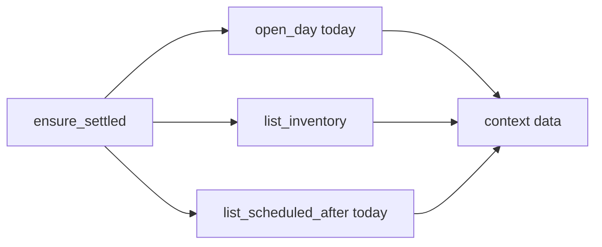

# Local Planner v2a Agent CLI 技术设计

| 字段 | 值 |
| --- | --- |
| 文档标题 | Local Planner v2a Agent CLI 技术设计 |
| 工作名 | Local Planner |
| 切片 | **v2a 仅 Agent CLI**（不含 v2b 时间字段，不含 v2c 自然语言窗口） |
| 作者 | TBD |
| 日期 | 2026-08-31 |
| 状态 | Draft（审查 9 条已处理） |
| 依据 | [v2-requirements.md](../product/v2-requirements.md)、[v2-decisions.md](../product/v2-decisions.md) V2-D1、[v1-requirements.md](../product/v1-requirements.md)、[decisions.md](../product/decisions.md) D1–D14、[v1-design.md](v1-design.md) |
| 仓库 | `/Users/anyuchen/Projects/personal/local-planner` |
| 代码现状 | v1 已落地：领域命令、SQLite、`serve` / `backup`、本机网页。当前 CLI 只有这两条进程命令，没有领域入口（见 `src/local_planner/__main__.py`） |

本文给实现者：按本文即可开工 v2a。产品范围以 v2 冻结需求的 **§5 Agent CLI** 为准。不推翻 D1–D14，不提前实现 v2b/v2c。

---

## Overview

v1 给人一条本机网页：打开即是今天，正经待办与差事两列，长期任务住在 To Do（库存）。v2a 给 **agent / 脚本** 一条稳定命令行，读写 **同一份** `planner.sqlite`、同一套 Asia/Shanghai「今天」、同一套日界结转与封印规则。

技术形态：CLI 是 **第二个适配器**，不是第二套业务。领域事实来源仍是 `src/local_planner/domain/commands.py` 与 `ensure_settled()`。跨进程协议是 **先 `fcntl.flock({data_dir}/planner.lock)`（fd 一直开着），再任何 sqlite 打开或 `BEGIN`**。HTTP **请求**在进程内先拿线程锁，再 flock（15s），再 `UnitOfWork.transaction()`（`BEGIN IMMEDIATE`）→ `ensure_settled` → 事务内 `clock.today()` → 命令。**30s 定时器**同样先线程锁，但 flock `timeout=0`，busy 则 skip，以免占住线程锁让网页空等 15s 才开始自己的 flock。stdout **只输出一份 JSON**，这才是契约；给人看的纯文本若有，只写 stderr，且必须显式打开。

人仍然用网页写今天（D1、D2）。CLI 不是 TUI，不打开浏览器，不要求 `serve` 已启动。`serve` 与 `backup` 保留，行为与 v1 兼容（backup 的 flock 超时改为 exit 3，见 API §3）。

---

## Background & Motivation

当前入口（`src/local_planner/__main__.py`）：

```python
# 仅 serve / backup；其它 argv → stderr「未实现」exit 1
python -m local_planner serve
python -m local_planner backup [路径]
```

网页能做的读写全部经 `local_planner.http.app.create_app` 调 `domain.commands`。agent 若要代操作，只能猜 HTTP 或点 DOM，二者都不接受（v2 §4、§5）。v2c 的自然语言窗口也 **必须先有** 这条 CLI：窗口只跑用户配置的脚本，脚本只许经 CLI 改计划。

若把 CLI 做成「自己算今天、自己结转」的快捷脚本，午夜后网页勾的和命令行勾的会分叉。v2 §9.1 已要求共用规则库。本设计把这条写成死规则。

`open_connection`（`src/local_planner/persistence/connection.py`）每次打开都会写：`mkdir`、`PRAGMA journal_mode=WAL`、`apply_migrations`（`BEGIN` 非 IMMEDIATE）、`_seed_timezone` 的 autocommit `INSERT OR IGNORE`、`PRAGMA integrity_check`。因此 flock 若放在 `SqliteUnitOfWork.open` **之后**，CLI 仍会在无 `planner.lock` 的情况下写库——这正是锁要防的窗口。v1 `serve()` 今天也是先 `open` 再拿线程锁；v2a 把启动 open 也收进 flock。

---

## Goals & Non-Goals

### Goals（v2a 必须）

1. **覆盖现有领域读写。** 网页今天能做的，agent 用命令也能做，规则相同。函数仍是 `commands.py` 里那些，不另发明 agent 专用业务。
2. **另加 `context`。** 一次打出：产品日历「今天」、是否可写、今天 Plan、今天 Errands、全部 To Do。这是给脚本的入口，不是新实体。
3. **JSON stdout 为契约。** 成功与失败都能被脚本解析。稳定字段名、稳定 id（Plan 用 `taskId`，Errands 用 `id`）。纯文本不是 API。
4. **稳定 id，禁止标题模糊匹配当主路径。** 写命令以 uuid 为主键。
5. **同一 sqlite、同一今天、同一结转、同一封印。** 数据文件仍是 `planner.sqlite`；`today` 只来自事务内 `clock.today()`（`Asia/Shanghai`）；每条领域命令路径调用 `ensure_settled`；过去日只读；未完成 Plan 回 To Do；未完成 Errands 作废；已封印永不解封。CLI 不是改历史的后门（D13）。
6. **不必先打开网页 / 不必先 `serve`。** CLI 自己打开库。禁止 `webbrowser.open`。
7. **与 `serve` 可同时跑而不腐蚀 sqlite。** 跨进程文件锁（在任何 sqlite 使用之前）+ 现有 `BEGIN IMMEDIATE`。
8. **保留 `serve` / `backup`。** 不是改掉现有两条，是在它们之外加领域子命令。
9. **为 v2b 留字段空间，但不实现。** 消费者必须忽略未知键；v2a **不**发出 `startClock` / `endClock` / `targetDate`。

### Non-Goals（本切片明确不做）

- v2b：To Do 目标日、Plan/Errands 时钟、小时表、滑动列表
- v2c：自然语言窗口、启动器分组、把 `context` 注入命令模板
- 给人用的 TUI / 交互式日视图 / REPL
- 打开浏览器、把 CLI 当 `serve` 的别名
- 手动封印 / 解封 / 改「今天是哪一天」/ `seal_day` / 内部 settle HTTP
- agent 用的 `debug`（`GET /api/debug` 仍只走 HTTP；CLI 不打印 `dbPath`）
- 新 HTTP 路由 `/api/context`（窗口在 v2c 调 CLI，不经过这条）
- schema 迁移、新表、IndexedDB、第二份 JSON 主存储
- 内置厂商 SDK、云账号、同步、系统通知
- 用 CLI 绕过 Origin 去打局域网——CLI 根本不走 HTTP
- 把 To Do 目标日当成排期（那是 v2b，且产品已否决「到期自动进 Plan」）

### 设计层已拍板、避免实现时再争论

| 决策 | 选择 | 原因 |
| --- | --- | --- |
| CLI 主路径 | **直接打开同一 sqlite**，不把 HTTP 当 RPC | 「不必先打开网页」；Origin/端口/serve 存活都不应成为前置 |
| 与 serve 共存 | **`{data_dir}/planner.lock` 上 `fcntl.flock`**，且 **flock 先于任何 sqlite 打开/`BEGIN`**；再加原 `BEGIN IMMEDIATE` | `threading.Lock` 跨不了进程；`open_connection` 本身会写库；只靠 `busy_timeout=5000` 不够作为产品契约 |
| 锁 fd | **持锁期间 fd 必须一直开着**。CLI：先 close uow 再 UNLOCK。serve 启动：UNLOCK **不** close uow | 关掉 fd 即释放 `fcntl.flock` |
| JSON 字段风格 | **camelCase，与 HTTP body 同形** | agent 可复用网页 JSON 形状；转换仍只发生在适配器，领域保持 snake_case |
| envelope / payload 的 `today` | **只**用本次 `BEGIN IMMEDIATE` 内 `clock.today()` | 对齐 v1 R13；禁止 commit 后再读时钟 |
| `LockTimeout` | 适配器错误：HTTP **503** `{error,message}`；CLI envelope + exit 3；backup stderr + exit 3 | 不是领域错误；409 已给 DaySealed/Conflict |
| HTTP 等待 | HTTP / CLI / backup / serve **启动** = `LOCK_TIMEOUT_SECONDS = 15`。**仅** `SettlementTimer` 在已持线程锁时用 flock `timeout=0` | 定时器若也等 15s，会占住无超时的线程锁，网页先卡 15s 才开始自己的 flock，无法在 15s 内 503 |
| `context` 是否带未来已排期 | **带 `scheduledAhead` 短列表** | 库存定义是未排期（v1）；agent 只看 context 会以为任务丢了。不是新业务对象 |
| `today` 日期词 | DATE 参数允许字面 `today`，**事务内**解析成该次 `clock.today()` | 与产品日历日对齐；此糖 **只存在于 CLI**，HTTP `from=today` 仍 400 |
| 人类可读输出 | 默认没有。`--pretty` / `--human` 挂在 **领域父解析器** 上；`--human` 写 stderr 一行中文 | 纯文本不是契约；不泄漏到 `serve`/`backup` |
| `serve` / `backup` 输出 | **保持 v1 人类文本**，不套 JSON envelope | 现有 README 与 `tests/test_scaffold.py` / backup 测试依赖 |
| `--port` | **只** `python -m local_planner serve --port N`（及 `LOCAL_PLANNER_PORT`） | README 已是此形；不再支持父解析器 `--port … serve` |
| `main()` 退出 | 领域路径 `return code`；除 `--help`/`-h` 外不 `sys.exit` | 测试可断言返回值；help 仍 `SystemExit` |
| 领域命令入口 | `python -m local_planner` 子命令；另加 console script `local-planner` | 短名字方便脚本；包入口仍是 `-m` |
| 路径/时钟函数 | 抽到 `paths.py`；CLI/`backup` **不得** import `http` | 避免每条 `context` 拉起 uvicorn |
| v2b 字段 | v2a **不发射** 时钟/目标日键；文档要求消费者忽略未知键 | 给随后切片加字段，而不把 null 冻进契约 |

---

## Key Decisions

1. **CLI 是适配器，领域是唯一事实来源。** 禁止在 `cli/` 里复制 `is_day_writable`、年份帽、结转、封印判断。写路径只许调用 `local_planner.domain.commands` 现有函数（`open_day`、`add_todo_on_day`、…）。`seal_day` / `Planner.seal_day` 不暴露。
2. **进程级协议（死规则）：先 flock，再碰 sqlite，再事务。** 顺序固定为：
   1. `mkdir(data_dir, exist_ok=True)`
   2. 打开 `{data_dir}/planner.lock`，`LOCK_EX`（轮询至超时），**fd 保持打开**
   3. **调用方**这才调用现有、**自身不含 flock** 的 `SqliteUnitOfWork.open` / `open_connection` / `backup_sqlite_file`（内部才 `sqlite3.connect`）
   4. 领域路径：`uow.transaction()`（内部唯一的 `BEGIN IMMEDIATE`）→ `ensure_settled(clock, uow)` → 事务内 `today = clock.today()` → 命令与 `*_payload(..., today)`
   5. CLI：关 uow。serve 启动：**不关** uow。backup：backup API 结束后关其临时连接
   6. 最后 UNLOCK 并 close 锁 fd
   CLI **不得**自己 `BEGIN` / `COMMIT`。`BEGIN IMMEDIATE` 继续只出现在 `SqliteUnitOfWork.transaction`。`open_connection` / `SqliteUnitOfWork.open` / `backup_sqlite_file` **保持无 flock**（persistence 单测继续直接 open tmp 库）。**禁止在未持 flock 时于生产路径 `connect`、跑迁移、`INSERT OR IGNORE` meta、`integrity_check`、或开写事务。** 禁止把 flock 写进 `persistence/`（否则 `exclusive_uow` 再 `open` 会二次加锁：Linux OFD flock 自死锁，macOS 进程级 flock 会把 bug 藏起来）。
3. **跨进程互斥用文件锁，不取代进程内线程锁。** `fcntl.flock` 在 macOS 上是进程级，挡不住 FastAPI 线程池 + 30s 定时器抢同一连接。serve **请求**仍先拿 `http` 包里的线程锁，再 flock（15s）。**定时器同样先线程锁，但 flock `timeout=0`**：busy 则立刻 skip，不得占着线程锁轮询 15s。CLI 只拿 flock。该线程锁的 **Python 标识符只许出现在 `src/local_planner/http/`**（含注释）；`runtime.py` / `paths.py` / `cli/` / `present.py` / `backup.py` 的源码与注释都不得含此标识符。
4. **stdout = 恰好一个 JSON 值 + 换行。** 日志、traceback 摘要、`--human` 文案、argparse usage 走 **stderr**。契约解析器只读 stdout。argparse usage 不得出现在 stdout。
5. **`data` 与对应 HTTP JSON 同形。** `day open` 的 `data` = `GET /api/days/:date`；`inventory list` 的 `data` = `GET /api/inventory`。抽出共享 `present.py`，HTTP 与 CLI 禁止各写一套 camelCase。`debug_payload` **留在** `http/app.py`（它读 `uow.conn`），不进 `present.py`。
6. **稳定 id。** Plan 条目主键是任务 id（JSON `taskId`）；Errands 主键是差事 id（JSON `id`）。跨日同一 `taskId`（D11）。没有「按标题找任务」命令。
7. **不提供改日历/解封。** 结转只发生在命令路径里的 `ensure_settled`，与网页相同。
8. **v2a 零 schema 变更。** 只允许给 `UnitOfWork` 增加只读查询 `list_scheduled_after`（无新表、无迁移文件）。`001_init.sql` 不动。
9. **`today` 绑定在事务内。** `planner_txn` 在 `with uow.transaction()` 内 yield `clock.today()`。envelope 的 `today`、所有 `*_payload(..., today)`、DATE 词 `today` 的解析，只用这个值。`present.py` 与 commit 之后 **禁止**再调 `clock.today()`。领域错误在 settle 之后发生时，失败 envelope **仍带** 该 `today`。`LockTimeout` / 纯 `UsageError` 发生在开库之前：省略 `today`。
10. **适配器错误不进 `domain/errors.py`。** `LockTimeout`、`InternalError` 放 `runtime.py`；`UsageError` 放 `cli/envelope.py`。`flock` 超时是 `LockTimeout`。已经持有 flock 之后的 `sqlite3.OperationalError`（`database is locked`）以及 `open_connection` 的 `sqlite3.DatabaseError`（如 integrity_check 失败）是 `InternalError`（不当成第二次 `LockTimeout`）。领域 `dispatch` 必须把这些打成 envelope + exit 4，stdout 不得只剩 traceback。
11. **三个入口三个帮手，禁止混用。** `exclusive_uow` **只给 CLI**（open → 工作 → **close** → 放锁）。serve 启动用 `open_persistent_uow`（flock → open → 一次 `planner_txn` → **放锁且 uow 保持打开**）。backup 只用 `interprocess_lock` + `backup_sqlite_file`，**不**进 `planner_txn`、**不** settle。

---

## Proposed Design

### 1. 进程与数据落点（沿用 v1）

```
默认库：~/Library/Application Support/local-planner/planner.sqlite
覆盖：  LOCAL_PLANNER_DATA_DIR（目录；文件名仍 planner.sqlite）
开发：  LOCAL_PLANNER_DEV=1 → 仓库 .data/planner.sqlite
锁文件：{data_dir}/planner.lock          ← v2a 新增
时钟：  local_planner.paths.resolve_clock()
        生产 SystemClock；测试 FrozenClock
        LOCAL_PLANNER_CLOCK 仅当 ALLOW_CLOCK_OVERRIDE=1
```

`data_dir` / `db_path` / `resolve_clock` 从 `http/serve.py` **抽到** `src/local_planner/paths.py`。`serve.py`、`backup.py`、CLI 都从 `paths` 引用。CLI 与 `backup.py` **不得** `import local_planner.http`（从而不在每条 `context` 时加载 uvicorn/FastAPI）。`open_connection` 的 pragmas / 迁移 / seed / integrity_check 不变，只是调用它之前必须已持 flock。

CLI **一次调用：持锁 → 打开、用完关闭 sqlite → 放锁**。不常驻、不复用 serve 的连接。serve 的长连接只在 **启动 open 已在 flock 内完成之后** 合法；之后每次 `_locked` / 定时器 / backup 仍要在 `BEGIN IMMEDIATE` 或 backup API **之前**再拿 flock。

### 2. 模块划分

```
src/local_planner/
  __main__.py              # 分发：serve / backup / 领域子命令；main() -> int
  paths.py                 # data_dir / db_path / resolve_clock
  runtime.py               # 文件锁、planner_txn、exclusive_uow（仅 CLI）、
                           # open_persistent_uow（仅 serve 启动）、configure_logging、
                           # LockTimeout / InternalError
  present.py               # camelCase：day_plan / inventory / command / calendar / meta
  cli/
    __init__.py
    parser.py              # 领域父解析器（--pretty/--human）+ 子命令
    envelope.py            # JSON envelope、UsageError、exit code
    dispatch.py            # argv → exclusive_uow → planner_txn → domain → envelope
  http/app.py              # 线程锁 → flock 15s → planner_txn；LockTimeout → 503
  http/serve.py            # open_persistent_uow；定时器：线程锁 + flock timeout=0
  backup.py                # interprocess_lock 后再 backup_sqlite_file；不 settle
  domain/commands.py       # 不变（context 不进领域包）
  persistence/store.py     # + list_scheduled_after；transaction() 不变
```

**禁令（沿 v1 测试钉死，v2a 不得打破）：**

| 字符串 / 行为 | 只许出现在 |
| --- | --- |
| 进程内线程锁的 Python 标识符（现有测试所扫的那个名字） | `src/local_planner/http/` |
| `BEGIN IMMEDIATE` | `persistence/store.py` 的 `SqliteUnitOfWork.transaction` |
| `ensure_settled` 自己 BEGIN / 拿锁 | 禁止（领域纯函数，保持） |
| `webbrowser` | 禁止出现在本包 |
| `LockTimeout` / `UsageError` / `InternalError` 类 | 适配器（`runtime.py` / `cli/envelope.py`），**不是** `domain/errors.py` |
| `interprocess_lock` / `fcntl.flock` | `runtime.py` 与其调用方（`cli/`、`http/`、`backup.py`）。**禁止**出现在 `persistence/` |

`tests/http/test_bind_and_origin.py::test_locked_path_is_lock_then_transaction_then_settle` 必须在 PR1 **改写**：HTTP `_locked` 源码仍要「线程锁名字 < `interprocess_lock`」。`planner_txn` 源码要满足 `transaction()` < `ensure_settled` < `clock.today()`。另测 CLI/`exclusive_uow`：flock 调用出现在 `SqliteUnitOfWork.open` **之前**（open 内部不得再 flock）。

### 3. 调用序

```mermaid
flowchart TB
  subgraph cliProc["CLI exclusive_uow"]
    FLockC["flock 15s 保持 fd"] --> OpenC["SqliteUnitOfWork.open"]
    OpenC --> TxnC["planner_txn"]
    TxnC --> CloseC["close uow → UNLOCK"]
  end
  subgraph serveStart["serve 启动 open_persistent_uow"]
    FLockS["flock 15s 保持 fd"] --> OpenS["SqliteUnitOfWork.open"]
    OpenS --> TxnS["planner_txn 一次"]
    TxnS --> Keep["UNLOCK，uow 保持打开"]
  end
  subgraph bak["backup"]
    FLockB["flock 15s"] --> BakApi["backup_sqlite_file"]
    BakApi --> UnB["UNLOCK 不 settle"]
  end
  subgraph httpReq["HTTP _locked 连接已开"]
    TLockH["线程锁"] --> FLockH["flock 15s"]
    FLockH --> TxnH["planner_txn"]
  end
  subgraph timer["30s SettlementTimer 连接已开"]
    TLockT["线程锁"] --> FLock0["flock timeout=0"]
    FLock0 -->|busy| Skip["log skip 立刻放线程锁"]
    FLock0 -->|got| TxnT["planner_txn"]
  end
```



伪代码（实现须保持此顺序，不得先 open 再锁）：

```python
# runtime.py
LOCK_TIMEOUT_SECONDS = 15  # 测试可 monkeypatch，禁止为测超时真等 15s

class LockTimeout(Exception):
    code = "LockTimeout"
    def __init__(self, message: str = "计划正忙，请重试"):
        self.message = message

class InternalError(Exception):
    code = "InternalError"
    def __init__(self, message: str):
        self.message = message

@contextmanager
def interprocess_lock(data_dir: Path, timeout: float = LOCK_TIMEOUT_SECONDS):
    data_dir.mkdir(parents=True, exist_ok=True)
    fd = os.open(data_dir / "planner.lock", os.O_CREAT | os.O_RDWR, 0o644)
    # timeout==0：LOCK_EX|LOCK_NB 一次，失败立即 LockTimeout（定时器专用）。
    # timeout>0：LOCK_NB 轮询 50ms 至 timeout；失败 close(fd) 并 raise LockTimeout
    # yield 期间必须保持 fd 打开。禁止 lock 后先 close fd 再开事务。
    try:
        yield
    finally:
        fcntl.flock(fd, fcntl.LOCK_UN)
        os.close(fd)

@contextmanager
def planner_txn(clock, uow):
    """调用方必须已经持有 interprocess_lock。yield 事务内 today。"""
    with uow.transaction():
        ensure_settled(clock, uow)
        yield clock.today()

@contextmanager
def exclusive_uow(data_dir: Path, sqlite_path: Path, timeout: float = LOCK_TIMEOUT_SECONDS):
    """仅 CLI：锁 → open → yield uow → close uow → 放锁。禁止 serve 用这个帮手。"""
    with interprocess_lock(data_dir, timeout=timeout):
        try:
            uow = SqliteUnitOfWork.open(sqlite_path)
        except sqlite3.Error as exc:
            raise InternalError("无法打开计划库") from exc
        try:
            yield uow
        finally:
            uow.close()

def open_persistent_uow(
    data_dir: Path, sqlite_path: Path, clock, timeout: float = LOCK_TIMEOUT_SECONDS
):
    """仅 serve 启动：锁 → open → 一次 planner_txn → 放锁，返回仍打开的 uow。"""
    with interprocess_lock(data_dir, timeout=timeout):
        try:
            uow = SqliteUnitOfWork.open(sqlite_path)
        except sqlite3.Error as exc:
            raise InternalError("无法打开计划库") from exc
        try:
            with planner_txn(clock, uow):
                pass
        except Exception:
            uow.close()
            raise
        return uow  # 退出 with 后锁已释放；调用方在进程退出时 close

def configure_logging() -> None:
    """与 serve 相同：LOCAL_PLANNER_LOG，默认 INFO。领域 CLI 的 main 必须调用。"""
    ...

# http/app.py
def _locked(ctx, fn):
    with <http 包内线程锁>:
        with interprocess_lock(ctx.data_dir, timeout=LOCK_TIMEOUT_SECONDS):
            with planner_txn(ctx.clock, ctx.uow) as today:
                return fn(today)

# http/serve.py
def serve(port: int | None = None) -> None:
    configure_logging()
    clock = resolve_clock()
    ddir, path = data_dir(), db_path()
    try:
        uow = open_persistent_uow(ddir, path, clock)  # 15s flock；失败则永不 bind
    except LockTimeout:
        print("计划正忙，请重试", file=sys.stderr)
        raise SystemExit(3)
    timer = SettlementTimer(clock, uow, ddir)
    timer.start()
    try:
        app = create_app(clock=clock, uow=uow, port=resolve_port(port), data_dir=ddir, ...)
        print(f"http://127.0.0.1:{resolve_port(port)}", flush=True)
        uvicorn.run(app, **uvicorn_run_kwargs(...))
    finally:
        timer.stop()
        uow.close()

# SettlementTimer._loop（已持有常驻 uow）
with <http 包内线程锁>:
    try:
        with interprocess_lock(self._data_dir, timeout=0):
            with planner_txn(self._clock, self._uow):
                pass
    except LockTimeout:
        logger.info("code=LockTimeout wait_s=0 skip")  # 立刻放线程锁

# backup.py — 不 settle、不用 exclusive_uow / planner_txn
with interprocess_lock(data_dir(), timeout=LOCK_TIMEOUT_SECONDS):
    return backup_sqlite_file(db_path(), dest)  # 内部才 connect

# cli/dispatch.py — 完整错误图，不是只有 LockTimeout/DomainError
configure_logging()
txn_today = None
try:
    with exclusive_uow(paths.data_dir(), paths.db_path()) as uow:
        with planner_txn(clock, uow) as today:
            txn_today = today
            data = handler(today)  # payloads 只用这个 today
    emit_ok(command, today=txn_today, data=data)
    return 0
except UsageError as exc:
    emit_fail(command, today=None, error=exc)  # 省略 today
    return 2
except LockTimeout as exc:
    emit_fail(command, today=None, error=exc)  # 省略 today
    return 3
except DomainError as exc:
    emit_fail(command, today=txn_today, error=exc)  # settle 后必有 today
    return 1
except InternalError as exc:
    emit_fail(command, today=txn_today, error=exc)  # 未 settle 则省略 today
    return 4
except Exception:
    logger.exception("cli unhandled")
    emit_fail(
        command,
        today=txn_today,
        error=InternalError("内部错误"),
    )
    return 4
```

`emit_ok` / 所有 `*_payload` 的 `today` 参数 **只**来自上面的 `txn_today` / `planner_txn` yield，禁止 `today=clock.today()` 再写一遍。

**锁顺序（死规则，防死锁）：**

| 角色 | 帮手 | 顺序 |
| --- | --- | --- |
| serve 请求 | `_locked` | 线程锁 → flock **15s**（fd 保持）→ `BEGIN IMMEDIATE` → commit → 放 flock → 放线程锁。连接不关 |
| 30s 定时器 | `SettlementTimer._loop` | 线程锁 → flock **`timeout=0`** → 若 busy：立刻 `LockTimeout`、放线程锁、skip。若拿到：`planner_txn` → 放 flock → 放线程锁。连接不关。**禁止**定时器使用 15s 等待 |
| serve 启动 | `open_persistent_uow` | flock 15s → `SqliteUnitOfWork.open` → 一次 `planner_txn` → **放 flock，uow 保持打开** |
| CLI 领域命令 | `exclusive_uow` | flock 15s → open → `planner_txn` → **close uow** → 放 flock |
| backup | 仅 `interprocess_lock` | flock 15s → `backup_sqlite_file`（内部才 `connect`）→ 放 flock。**不** `planner_txn`、**不** settle |

禁止：先 open/connect 再 flock；先关锁 fd 再 BEGIN；serve 请求/定时器先 flock 再等线程锁（与 CLI 交叉会死锁）；`serve()` 调用 `exclusive_uow`（会把常驻连接关掉）；backup 包进 `planner_txn`；在 `SqliteUnitOfWork.open` / `open_connection` / `backup_sqlite_file` 内 flock。

`LOCK_TIMEOUT_SECONDS = 15`。超时 → `LockTimeout`，计划不变。flock 在进程退出（含 SIGKILL）时由内核释放，无 stale lock 协议。锁文件可空；不要把标题或路径写进去。测试通过 monkeypatch 该常数为 `0.2`，禁止集成测试真等 15 秒。

**`LockTimeout` 适配器映射（PR1 起，全进程）：**

| 入口 | 行为 |
| --- | --- |
| HTTP `_locked`（`/api/health` 除外） | **503** `{"error":"LockTimeout","message":"计划正忙，请重试"}`。不泄漏路径。SPA 已认 `{error, message}` |
| 领域 CLI | envelope `error.code=LockTimeout`，省略 `today`，exit 3 |
| `backup` | stderr 一行中文（非 JSON），**exit 3**（不是今天的 sqlite 失败 exit 1） |
| `serve` 启动 | stderr 说明拿不到锁，**不 bind 端口**，进程 exit 3 |
| 30s 定时器 | 已持线程锁时 flock **`timeout=0`**。busy → 日志 `code=LockTimeout wait_s=0`，**立刻 skip 本轮并放线程锁**。不向浏览器发 503，不让定时器把 serve 打挂 |

**网页等待上界（产品后果，写死）：** 用户一次 API 最多被线程锁挡住一段 **在途临界区**（另一请求或定时器已拿到 flock 并在 settle/命令中，P99 < 50ms），**加上本请求自己最多一次 15s flock**。因此 CLI/`backup` 持锁时，该次 HTTP 应在约 15s 内 503，而不是先等定时器 15s 再 flock 15s。v2a **不**给 HTTP 另设更短超时。同一浏览器连续两个请求可能排队在第一个的 15s 后面——那是第二请求，不放宽本请求上界。

已经持有 flock 之后若仍出现 `sqlite3.OperationalError` / `database is locked`：视为 `InternalError`（HTTP 500 `{error:"InternalError", message:"…"}`，CLI envelope exit 4）。Issue 1 修好后这应当极罕见，不要映射成第二个 `LockTimeout`。

`GET /api/health`：仍不拿线程锁、不 flock、不结转（活性探针）。

**`create_app` / `SettlementTimer` 的 `data_dir`：**

- `AppContext.data_dir: Path` 必填。
- `create_app(..., data_dir: Path | None = None)`：若省略，**只许**从该 `uow` 的 sqlite 文件路径推导（`PRAGMA database_list` 的 `file` 的 parent）。**禁止**默认 `paths.data_dir()` / `~/Library/Application Support/local-planner`。内存仓或空路径 → 抛错，不要静默用生产目录。
- 测试夹具注释「Never the real data dir」继续成立：HTTP 测试的 sqlite 已在 `tmp_path`，推导结果即 `tmp_path`。仍应在 PR1 改每一处 `create_app(`，显式传入 `tmp_path` 更清晰。
- `SettlementTimer.__init__(clock, uow, data_dir, interval=…)`，无生产默认。
- CLI 测试：在调用 `main(argv)` **之前** 把 `LOCAL_PLANNER_DATA_DIR` 设为 tmp 目录，使锁、库、backup 默认目标都落在夹具内。

PR1 必须改到的 `create_app(` 调用点（不仅 conftest）：

| 文件 | 说明 |
| --- | --- |
| `src/local_planner/http/serve.py` | 传入启动用的同一 `data_dir()` |
| `tests/http/conftest.py` | `app` fixture |
| `tests/http/test_bind_and_origin.py` | 至少 3 处 |
| `tests/http/test_sealed_rejects.py` | 2 处 |
| `tests/http/test_inventory_api.py` | 1 处 |
| `tests/http/test_spa_fallback.py` | `spa_client` fixture |

### 4. `context` 组装

`context` **不是** `domain/commands.py` 里的新命令，避免把「给脚本的打包」做成业务对象。适配器在已经 `ensure_settled` 的同一事务里组合三次只读：

1. `cmds.open_day(clock, uow, today)` — 今天 Plan + Errands
2. `cmds.list_inventory(uow)` — 全部 To Do
3. `uow.list_scheduled_after(today)` — 今天之后仍占排期的未完成任务

`today` 即 `planner_txn` yield 的那一个。



不塞进 `context` 的（产品 §5.3）：完整历史、任意过去日全文、未来所有已排期日的完整 DayPlan。agent 要看某一天，再调 `day open DATE`。

### 5. 日期词 `today`

凡 **CLI** DATE 参数（含 `calendar --from/--to`、`--date`、`day open`、`day todo add` 等）：

- `YYYY-MM-DD` 且 `date.fromisoformat` 成功 → 用该日（非法 → `ValidationError`，与 `parse_calendar_date` 相同）
- 字面 `today`（全小写）→ 用 **本次** `planner_txn` yield 的 `clock.today()`
- `day open` 省略 DATE → 等同 `today`

禁止：`yesterday`、相对 `+1`、OS locale 日期。年份帽只作用于 **写入**（已在 `require_writable_day`）；只读打开很远的日子与 HTTP 相同。

此糖 **只在 CLI**。HTTP 继续把 `from=today` 当成非法日期 → 400 `ValidationError`（`parse_calendar_date`）。不要改 HTTP 去接受 `today` 字符串。

### 6. 共享 JSON 视图（`present.py`）

从 `http/app.py` 抽出并给 CLI 复用（字段不得漂移）。`get_meta` 今天是内联字典；抽出为 `meta_payload`。**不要**移动 `debug_payload`（继续留在 `http/app.py`，它碰 `uow.conn`）。

- `day_plan_payload(plan, today)` — `date/serverToday/isToday/isPast/isFuture/writable/status/todos/errands`
- `inventory_item_payload(item)` — `taskId/title/createdAt`
- `command_payload(result, today)` — `DayPlan | InventoryItem | None`
- `calendar_payload(uow, start, end, today)`
- `meta_payload(uow, today)` — `today` 由调用方传入，present 内不读时钟

todos 项（v2a，与现网完全一致）：

```json
{"taskId": "…", "title": "把设计文档写完", "completedOnDay": false, "sortOrder": 0}
```

errands 项：

```json
{"id": "…", "title": "打印材料", "status": "open", "sortOrder": 0}
```

标题来源：日视图用 `title_snapshot`（`day_plan_payload` 已如此），保证过去日不被后来改名污染。

**v2b 预留（本切片不实现、不发射）：**

| 对象 | 将来可能多出的键 | 语义（只作占位说明） |
| --- | --- | --- |
| Plan todo | `startClock`, `endClock` | 可选 `"HH:MM"`，跟当天那次出现走（V2-D6） |
| Errand | 同上 | 与 Plan 同一套（V2-D3） |
| inventory item | `targetDate` | 可选 `YYYY-MM-DD` 目标日，不是排期（V2-D2） |

v2a 测试钉死 **恰好** 这些键；agent 实现必须 **忽略未知键**，以便 v2b 加法变更。禁止在 v2a 输出 `"startClock": null` 占位——那会把 null 冻成契约。

### 7. `list_scheduled_after`（唯一允许的持久化增量）

`UnitOfWork` 协议与 `InMemoryUnitOfWork` / `SqliteUnitOfWork` 增加：

```python
def list_scheduled_after(self, after: CalendarDate) -> list[Task]:
    """completed_at IS NULL AND current_scheduled_date > after。
    排序：current_scheduled_date ASC, created_at ASC。"""
```

SQL：

```sql
SELECT id, title, created_at, current_scheduled_date,
       completed_at, completed_on_date
FROM tasks
WHERE completed_at IS NULL
  AND current_scheduled_date IS NOT NULL
  AND current_scheduled_date > ?
ORDER BY current_scheduled_date ASC, created_at ASC, rowid ASC;
```

在 `ensure_settled` 之后调用：指向过去日的排期指针应已被结转清掉。不扫描 `day_task_entries` 做「历史曾出现」。

无此查询则 `scheduledAhead` 无法在不泄漏 `conn` 的前提下实现。禁止 CLI 直接 `uow.conn.execute`。

---

## API / Interface Changes

### 1. 进程命令 vs 领域命令

解析器拆成两棵，避免领域 flag 漏到进程命令：

- **进程：** `serve`、`backup` — v1 人类输出。`serve` 独有 `--port`。
- **领域：** 其余子命令挂在领域父解析器下，父解析器拥有 `--pretty`、`--human`。

| 类别 | 子命令 | stdout 契约 | 锁 |
| --- | --- | --- | --- |
| 进程 | `serve` | 仍打印 `http://127.0.0.1:{port}`，阻塞 | 启动：`open_persistent_uow`。请求：线程锁 + flock 15s + settle。30s：线程锁 + flock timeout=0 + settle 或 skip |
| 进程 | `backup [路径]` | 仍打印 `已备份到 …`（stderr 错误） | flock → 然后才 connect；**不** settle |
| 进程 | 无参数 / `--help` / `-h` | argparse 人类帮助，exit 0（`SystemExit`） | 否 |
| 领域 | 下表全部 | **JSON envelope** | `exclusive_uow` + `planner_txn` |

**唯一支持的换端口写法**（与现 README 一致）：

```bash
python -m local_planner serve --port 9000
# 或 LOCAL_PLANNER_PORT=9000 python -m local_planner serve
```

`python -m local_planner --port 9000 serve` **不再支持**（父解析器不再挂 `--port`）。无测试覆盖旧形。

console script（`pyproject.toml` `[project.scripts]`）：

```
local-planner = "local_planner.__main__:main"
```

与 `python -m local_planner` 同源。README 两种都写，测试钉 `python -m local_planner`。

`main(argv) -> int`：领域路径打印 envelope 后 **return** 0/1/2/3/4，不 `sys.exit`。`--help`/`-h` 仍走 argparse 的 `SystemExit`。`serve`/`backup` 的非法 flag 可维持 argparse `SystemExit`（人类 usage 在 stderr）。`tests/test_scaffold.py::test_unknown_command` 改为 `assert main(["not-a-command"]) == 2` 且 `json.loads(stdout)`，不要 `pytest.raises(SystemExit)`（`--help` 那条除外）。

### 2. JSON envelope（契约）

成功：

```json
{
  "ok": true,
  "v": 1,
  "command": "day.open",
  "today": "2026-08-30",
  "data": { }
}
```

失败（settle 之后的领域错误，带事务内 today）：

```json
{
  "ok": false,
  "v": 1,
  "command": "day.todo.complete",
  "today": "2026-08-30",
  "error": {
    "code": "DaySealed",
    "message": "这一天已封印，不能改",
    "date": "2026-08-29"
  }
}
```

规则：

- `ok`：布尔。脚本先读这个。
- `v`：envelope 版本，v2a = `1`。v2b 加 data 内字段 **不** 升这个数字；只有破坏字段改名/删除才升。
- `command`：下表「envelope command」列，稳定点分名。完全无法识别子命令时为 JSON `null`。
- `today`：本次 `planner_txn` 内 `clock.today()`。开库/拿锁之前的失败（`UsageError`、`LockTimeout`）**省略**该键，不得用 OS 日或第二次 `clock.today()` 顶上。
- `data`：成功时必有；失败时省略。形状 = 对应 HTTP JSON（`context` 除外，见下）。
- `error.code`：`ValidationError` | `NotFound` | `DaySealed` | `Conflict` | `UsageError` | `LockTimeout` | `InternalError`。前四个与 `domain/errors.py` 的 `exc.code` 相同；后三个不是领域类。
- `error.message`：中文短句，给人/模型看，**不是**稳定解析键。
- `error.date`：仅 `DaySealed` 且领域提供了 `exc.date` 时出现。
- `json.dumps(..., ensure_ascii=False)`，默认 compact（`separators=(",", ":")`）。`--pretty` → `indent=2`。末尾一个 `\n`。只使用 JSON 原生类型。
- 禁止在 stdout 打第二份 JSON、日志、argparse usage 或进度。缺 `--title`、未知命令：stdout **仍然**恰好一份 JSON；usage 若有则 stderr。

`--pretty` / `--human` 只存在于领域父解析器。`serve --pretty` 应是 argparse 人类错误（非 envelope）。`--human`：stderr 一行中文摘要，例如 `今天 2026-08-30 可写 · Plan 3 · Errands 1 · To Do 4 · 未来已排 2`。不进入契约，不测精确文案（可测「stderr 非空且 stdout 仍是合法 envelope」）。stderr 上同时出现日志、`--human`、usage 是允许的；**日志格式不是解析契约**。

### 3. 退出码

| code | 何时 |
| --- | --- |
| 0 | `ok: true`；`serve` 正常退出；无参数/`--help` |
| 1 | 领域错误：`ValidationError` / `NotFound` / `DaySealed` / `Conflict`；`backup` 的文件/sqlite 失败（与 v1 相同，**不含** flock 超时） |
| 2 | `UsageError`（未知子命令、缺参、坏 flag）。`main()` **return 2** |
| 3 | **仅** `LockTimeout`（flock 15s 内拿不到）。CLI / backup / serve 启动 |
| 4 | `InternalError`（完整性检查失败、持锁后的 sqlite busy、未预期异常）。stderr 可打 traceback；CLI stdout 仍是 envelope |

未知子命令不再打印「未实现」：改为 envelope `UsageError`（无 `today`，`command: null`）+ return 2。

### 4. 命令表

调用形如：`python -m local_planner <argv…>`。`--title` 一律选项（标题可含空格、可像 `-n`）。DATE 为 `YYYY-MM-DD` 或 `today`。id 为 uuid 字符串，位置参数。

| envelope `command` | argv | 领域函数 | HTTP 对照 | 成功 `data` |
| --- | --- | --- | --- | --- |
| `meta` | `meta` | （读 meta + inventory 计数） | `GET /api/meta` | `{today, timezone, lastSettledDate, inventoryCount}` |
| `context` | `context` | `open_day` + `list_inventory` + `list_scheduled_after` | 无 | 见 §5 |
| `calendar` | `calendar --from D --to D` | `calendar_payload` | `GET /api/calendar?from=&to=` | `{today, days:[{date, todoCount, errandCount}]}` |
| `day.open` | `day open [DATE]` | `open_day` | `GET /api/days/:date` | `day_plan_payload` |
| `day.todo.add` | `day todo add DATE --title TEXT` | `add_todo_on_day` | `POST /api/days/:date/todos` | `day_plan_payload` |
| `day.todo.complete` | `day todo complete DATE TASK_ID` | `complete_task_on_day` | `POST /api/days/:date/todos/:id/complete` | 同上 |
| `day.todo.uncomplete` | `day todo uncomplete DATE TASK_ID` | `uncomplete_task_on_day` | `…/uncomplete` | 同上 |
| `day.todo.reorder` | `day todo reorder DATE [TASK_ID …]` | `reorder_todos` | `PUT /api/days/:date/todos/order` | 同上 |
| `day.errand.add` | `day errand add DATE --title TEXT` | `add_errand` | `POST /api/days/:date/errands` | 同上 |
| `day.errand.reorder` | `day errand reorder DATE [ERRAND_ID …]` | `reorder_errands` | `PUT /api/days/:date/errands/order` | 同上 |
| `inventory.list` | `inventory list` | `list_inventory` | `GET /api/inventory` | `{items:[inventory_item_payload]}` |
| `inventory.add` | `inventory add --title TEXT` | `add_to_inventory` | `POST /api/inventory/tasks` | `inventory_item_payload` |
| `task.schedule` | `task schedule TASK_ID --date DATE` | `schedule_to_date` | `POST /api/tasks/:id/schedule` | `day_plan_payload`（目标日） |
| `task.unschedule` | `task unschedule TASK_ID` | `unschedule` | `POST /api/tasks/:id/unschedule` | `inventory_item_payload` |
| `task.rename` | `task rename TASK_ID --title TEXT` | `rename_task` | `PATCH /api/tasks/:id` | `command_payload`（见下方判别） |
| `task.delete` | `task delete TASK_ID` | `delete_task` | `DELETE /api/tasks/:id` | `{"ok": true}`（嵌套，见下方） |
| `errand.complete` | `errand complete ERRAND_ID` | `complete_errand` | `POST /api/errands/:id/complete` | `day_plan_payload` |
| `errand.uncomplete` | `errand uncomplete ERRAND_ID` | `uncomplete_errand` | `…/uncomplete` | 同上 |
| `errand.rename` | `errand rename ERRAND_ID --title TEXT` | `rename_errand` | `PATCH /api/errands/:id` | 同上 |
| `errand.delete` | `errand delete ERRAND_ID` | `delete_errand` | `DELETE /api/errands/:id` | 同上 |

Reorder 的 id 列表必须是当天该列的 **恰好排列**（集合相等），否则领域 `Conflict`——CLI 不得自行补齐或丢掉。argv 用 `nargs='*'`（不是 `+`）：空天 `day todo reorder DATE` / `day errand reorder DATE` 对应 HTTP `{"taskIds":[]}` / `{"errandIds":[]}`，合法。

**`task.rename` 判别：** `data` 与 HTTP 一样可能是 DayPlan 或 InventoryItem。脚本用 **`"todos" in data`**（有则 DayPlan，含 `date`/`todos`/`errands`）；否则是 InventoryItem（有 `taskId`，无 `todos`）。不要用「有没有 `taskId`」——DayPlan 的 todo 项也有 `taskId`，但顶层没有。

**`task.delete` 嵌套 `ok`：** envelope 已有 `"ok": true`，`data` 仍是 HTTP 的 `{"ok": true}`。成功以 **envelope `ok`** 为准；不要只读 `data.ok`。保留嵌套是为了 `data` 与 HTTP body 同形。

**`calendar --from` / `--to` 都必填**，不默认「本月」。产品只要月历占位，调用方给范围。两参数都是 DATE，故 CLI 可写 `--from today --to 2026-09-30`；HTTP 没有这个词。

**不进入 CLI：** `seal_day`、手动 `ensure_settled`、`GET /api/debug`、`GET /api/health`、任何「set-today」。

### 5. `context` 的 `data`

```json
{
  "today": "2026-08-30",
  "timezone": "Asia/Shanghai",
  "writable": true,
  "status": "open",
  "lastSettledDate": "2026-08-30",
  "inventoryCount": 2,
  "todos": [
    {
      "taskId": "aaaaaaaa-bbbb-4ccc-8ddd-eeeeeeeeeee1",
      "title": "把设计文档写完",
      "completedOnDay": false,
      "sortOrder": 0
    }
  ],
  "errands": [
    {
      "id": "aaaaaaaa-bbbb-4ccc-8ddd-eeeeeeeeeee2",
      "title": "打印材料",
      "status": "open",
      "sortOrder": 0
    }
  ],
  "inventory": [
    {
      "taskId": "aaaaaaaa-bbbb-4ccc-8ddd-eeeeeeeeeee3",
      "title": "竞赛报名",
      "createdAt": "2026-08-20T10:00:00Z"
    }
  ],
  "scheduledAhead": [
    {
      "taskId": "aaaaaaaa-bbbb-4ccc-8ddd-eeeeeeeeeee4",
      "title": "周四答辩",
      "date": "2026-09-03"
    }
  ]
}
```

- `todos` / `errands`：仅 **今天**，顺序 = `sort_order`，形状与 `day.open` 列表项相同。
- `inventory`：全量 To Do，`created_at DESC`（与 `list_inventory` / HTTP 相同）。
- `scheduledAhead`：`current_scheduled_date > today` 的未完成任务。今天的排期只出现在 `todos`，不重复进此列。空则 `[]`，键必须在。
- `writable` / `status`：对今天这张日计划，沿用 `is_writable(plan, today)`，此处 `today` 即事务内值。

### 6. 失败映射（与 HTTP 同码，不同包装）

| 情况 | `error.code` | HTTP | CLI exit |
| --- | --- | --- | --- |
| 空标题、坏日期、写入年份帽 | `ValidationError` | 400 | 1 |
| 未知 task / errand | `NotFound` | 404 | 1 |
| 写过去日 / 已封印（含虚拟过去空日） | `DaySealed` | 409 | 1 |
| 已完成再排期、Reorder 集合不对、expired 差事恢复、有封印历史还删任务、同一任务两天 | `Conflict` | 409 | 1 |
| 缺参、未知子命令 | `UsageError` | —（进程命令走 argparse） | 2 |
| 15s 内拿不到 `planner.lock` | `LockTimeout` | **503** `{error,message}` | 3 |
| 持锁后 sqlite busy / integrity / 未捕获 | `InternalError` | 500 `{error,message}` | 4 |

非法写过去日 → 失败且计划不变（rollback）。id 不存在 → 结构化失败，不静默改别的条目。同一未完成任务不能同时排两天——领域 `reject_second_open_schedule` 已保证，CLI 不得绕过。

`create_app` 增加 `LockTimeout` / `InternalError` 的 exception handler（与 `DomainError` 并列）。不要指望 `DomainError` 处理器接住它们。

CLI `dispatch` 的 `try/except` 必须覆盖 `UsageError`（2）、`LockTimeout`（3）、`DomainError`（1）、`InternalError` 与未捕获异常（4）。`open_connection` 在 flock 内抛出的 `sqlite3.Error` 由 `exclusive_uow` 收成 `InternalError`；不得让 traceback 单独占 stdout。`InternalError` 若发生在 `planner_txn` 之前（例如 integrity_check 失败），省略 envelope `today`。

用法错误示例（stdout；无 `today`）：

```json
{
  "ok": false,
  "v": 1,
  "command": null,
  "error": {
    "code": "UsageError",
    "message": "未知命令 not-a-command"
  }
}
```

`command` 在完全无法识别子命令时为 `null`。能识别到子命令但缺 `--title` 时，`command` 仍填点分名（例如 `day.todo.add`），仍无 `today`（尚未开库）。

领域 `ArgumentParser.error`：构造 `UsageError`，由 `main` 打印 envelope 并 `return 2`。禁止在领域路径 `sys.exit(2)`。

### 7. 日志（stderr）

领域 CLI 的 `main` 必须调用 `runtime.configure_logging()`（与 `serve()` 相同读 `LOCAL_PLANNER_LOG`，默认 **INFO**）。否则默认 WARNING，承诺的 `cli command=…` 行不会出现。

```
cli command=day.todo.complete ok=true ms=6
cli command=day.todo.complete ok=false code=DaySealed date=2026-08-29 ms=4
cli command=context ok=false code=LockTimeout wait_s=15 ms=15012
```

拒绝封印写时沿用 `reject code=DaySealed date=…`。

**日志与 `--human` 都不是解析契约。** 脚本只解析 stdout JSON。stderr 行数不保证。

---

## Data Model Changes

**无 schema 变更。** 不新增 `00N_*.sql`。`tasks` / `days` / `day_task_entries` / `errands` / `meta` 不动。不提前加时钟列、目标日列。

唯一增量：`UnitOfWork.list_scheduled_after`（查询，不是表）。`scheduledAhead` 是读模型投影。

`{data_dir}/planner.lock` 是空锁文件，不是数据库的一部分；备份 sqlite **不必** 拷它。重置库（删 `planner.sqlite*`）后锁文件可留可删，不影响正确性。

---

## Alternatives Considered

### A. serve 在则 CLI 当 HTTP 客户端，否则直连 sqlite

- 优点：serve 活着时只有一个 Python 写者，复用 Origin 背后那条连接与进程内线程锁。
- 缺点：两条代码路径；要发现端口；突变请求的 Origin 规则；serve 刚启动或卡在迁移时行为抖动；「不必先打开网页」变成「最好先打开」；v2c 脚本还要处理 ECONNREFUSED 再回退。
- **不用作 v2a 主路径。** 日后若要优化，只能作为隐藏传输，不能改变 argv/JSON 契约。

### B. 不做文件锁，只靠 WAL + `PRAGMA busy_timeout=5000` + `BEGIN IMMEDIATE`

- 优点：零新文件；sqlite 本就能单写者排队。
- 缺点：5s 对「正在补结转很多天 + HTTP 请求 + CLI 连打」偏紧，超时变成原始 `sqlite3.OperationalError`，agent 难看懂；v1 明确不喜欢第二份写者（`workers=1`）；`open_connection` 的 autocommit 写入发生在任何 `BEGIN IMMEDIATE` 之前；产品需要第一类错误码 `LockTimeout`。
- **不用作唯一机制。** 仍保留 `BEGIN IMMEDIATE` 与 `busy_timeout` 作第二道闸。

### C. pidfile 互斥：serve 在则拒绝 CLI（或反过来）

- 优点：实现简单。
- 缺点：直接违反「人用网页、agent 同时代操作」和 v2c「窗口嵌在现有网页里、背后跑脚本」——窗口开着时 CLI 必须能写。
- **不用。**

### D. 采用：flock（先于 sqlite 打开）+ 原事务协议（本文）

跨进程 flock 把 CLI 与 serve 的 **open + 临界区** 排成队；进程内线程锁继续保护 HTTP 线程与 30s 定时器；定时器 flock 不等待。领域与 UoW 合同不变。锁 fd 在临界区保持打开。

---

## Security & Privacy

威胁模型仍是「单用户、本机、无账号」。CLI 是本机用户的本地数据接口，不是新的网络面。

| 威胁 | 严重度 | 缓解 |
| --- | --- | --- |
| 局域网读计划 | 中（既有） | CLI 不听端口。`serve` 仍只绑 `127.0.0.1`。禁止把 bind 改成 `0.0.0.0` |
| CLI 把 `dbPath` / 家目录打进 stdout | 中 | 领域 envelope **不含** 路径。不提供 `debug` 子命令。`LockTimeout` HTTP 体也不含路径。`backup` 只打印目标路径 |
| 日志泄漏待办标题 | 低 | 默认只打 command / id 级计数 / error code；与 v1 相同 |
| 恶意网页打 CLI | 低 | CLI 不是 HTTP。v1 CSRF 规则只约束 `serve` |
| 脚本把计划 POST 到云 | 低（产品外） | 产品不内置上传。v2c 启动器是用户自己的命令，不在本切片 |
| 与 serve 并发写坏库 | 高 | flock **先于 open** + `BEGIN IMMEDIATE` + 触发器；**跨进程**并发测试 |
| 测试 flock 打到真实 Application Support | 高 | `create_app` 绝不默认生产 `data_dir()`；从 tmp sqlite 路径推导或显式 `tmp_path` |
| `--title` / argv 被 shell 历史记录 | 低 | 本机信任边界；不在设计里做 hidden prompt |

数据仍只在这台 Mac。无遥测。CLI 不发起网络请求。

---

## Observability

无指标集群。沿用 v1 stderr 键值日志。

- 领域 CLI：先 `configure_logging()`，再 `cli command=… ok=… ms=…`，失败加 `code=`；`LockTimeout` 加 `wait_s=`
- serve：现有 `http method=…`；结转 `settled …`；HTTP `LockTimeout` 记 `status=503`
- 调试日界：仍用 `GET /api/debug` 或看水位；不在 CLI 复制 debug 载荷
- 测试冻结时钟：同一套 `LOCAL_PLANNER_CLOCK` + `LOCAL_PLANNER_ALLOW_CLOCK_OVERRIDE=1`，且只对副本库
- stderr 日志 **best-effort**，不是契约

---

## Rollout

无功能开关。本机装上即是 v2a。

### 如何运行（领域命令示例）

```bash
python -m local_planner context
python -m local_planner meta
python -m local_planner day open today
python -m local_planner day todo add today --title "把设计文档写完"
python -m local_planner inventory list
python -m local_planner task schedule "$TASK_ID" --date 2026-09-03
python -m local_planner backup
python -m local_planner serve
python -m local_planner serve --port 9000
```

不打开浏览器。`serve` 仍可另开。两边同时写同一 `LOCAL_PLANNER_DATA_DIR`。若 CLI 正持锁，该次 HTTP 在线程锁上最多等一段在途临界区（P99 < 50ms），再加自己的 flock ≤15s，然后 503 `LockTimeout`；刷新即可。定时器不会再叠一段 15s。

### 回滚

停用领域子命令即可；库格式与 v1 相同。回滚代码后旧 `serve` 仍能打开。`planner.lock` 残留空文件无害。

### 重置

与 v1 相同：停进程，删 `planner.sqlite*`。

---

## Testing Strategy

领域测试继续不启 HTTP、不启 CLI。CLI 测试用临时目录 sqlite + `FrozenClock`，经 `main(argv)` 调，解析 stdout JSON。**禁止**测网页。新目录：

```
tests/cli/conftest.py          # tmp sqlite、clock、先设 LOCAL_PLANNER_DATA_DIR
tests/cli/test_envelope.py
tests/cli/test_parser.py
tests/cli/test_reads.py        # meta / day open / inventory / calendar
tests/cli/test_writes.py
tests/cli/test_context.py
tests/cli/test_sealed.py
tests/cli/test_lock.py         # 跨进程重叠写（PR3）
tests/runtime/test_lock.py     # 跨进程 flock 超时 / 等待（PR1）
tests/http/test_lock_timeout.py  # HTTP 503 LockTimeout（PR1）
```

macOS 上 `fcntl.flock` 是 **进程级**：同一 pytest 进程里 `TestClient` + `main()` **不能**证明互斥（第二个 flock 会成功）。凡声称测 flock 的用例必须 `subprocess` / `multiprocessing` 起 **第二个进程**。

### 必须自动化

1. **stdout 契约：** 成功/失败都是一份 JSON；`ok` 与 `main()` 返回码一致；`ensure_ascii=False` 中文标题往返。未知命令与缺 `--title`：`json.loads(stdout)` 成功，usage 不在 stdout。`InternalError`（例如 monkeypatch `open` 抛 `sqlite3.DatabaseError`）stdout 仍是 envelope、exit 4，不是裸 traceback。
2. **`--help` / 无参数：** 非 JSON，`SystemExit` 0；不碰库。
3. **`serve` / `backup`：** 仍非 envelope；backup 测试继续过。`serve --pretty` 不是领域 envelope。
4. **未知命令：** `UsageError` JSON，`command` 为 `null`，无 `today` 键，`main(...) == 2`。
5. **`context`：** 含今天 todos/errands、全量 inventory、仅未来的 `scheduledAhead`；今天的任务不出现在 `scheduledAhead`。
6. **稳定 id：** `day todo add` 返回的 `taskId` 再 `complete` / `unschedule` / 跨日 `schedule` 仍是同一个。
7. **DATE=`today`：** 冻结 2026-08-30，`day open today` 的 `data.date==2026-08-30`；**写路径** `day todo add today --title x` 的条目也在 2026-08-30，envelope `today` 与 `data.serverToday` 相同。
8. **过去日写失败：** `day todo add 2026-08-29 --title x` → `DaySealed`，envelope **有** `today`（冻结的 2026-08-30），库不变；`day open 2026-08-29` 读成功 `writable=false`。
9. **结转：** 冻结跨午夜后跑 `context`（或 PR2 用 `meta`），昨天未勾待办回 inventory，未勾差事 `expired`，新今天干净。CLI 路径必须进过 `ensure_settled`。
10. **不复制领域：** `cli/` 源码不得出现 `last_settled_date` 结算循环、`seal_day`、`BEGIN IMMEDIATE`。
11. **payload 同源：** `present.day_plan_payload` 与 HTTP `GET /api/days` 的 keys 集合测试相等。
12. **跨进程 flock（PR1）：** 进程 A 持有 `planner.lock`（可同时持 `BEGIN IMMEDIATE`）。进程 B 调用 **`exclusive_uow` / `backup()` / `open_persistent_uow`（或 `serve` 启动）**，**不得**直接调 `SqliteUnitOfWork.open` 来充当本条。B 在 A 放锁前不得返回成功；timeout 缩短为 0.2s 时 B 得到 `LockTimeout`，**不是** seed/migrate 阶段的 raw sqlite busy。A 放锁后 B 经同一帮手能成功。另断言 `persistence/` 源码不含 `interprocess_lock` / `fcntl.flock`；persistence 单测继续无 `planner.lock` 地 `SqliteUnitOfWork.open(tmp)`。
13. **跨进程重叠写（PR3 最晚）：** 两个 **subprocess** 同时 `inventory add`（或 CLI vs `uvicorn`/HTTP 子进程），最终两条都在，`integrity_check=ok`。禁止用同进程 `TestClient` + `main()` 充当本条。
14. **Reorder：** 空列表在空天成功；集合错误 exit 1，`Conflict`。
15. **有封印历史 DeleteTask：** `Conflict`，中文消息可含「过去的某一天还记着它」。
16. **v2a 不发射时间键：** todos/errands/inventory 项 keys 白名单断言。
17. **线程锁标识符仍不出现在非 `http/` 源码（含注释）**；`BEGIN IMMEDIATE` 仍只在 `persistence/store.py`；`persistence/` 不含 `interprocess_lock` / `fcntl`。
18. **不打开浏览器：** `cli/` 与 `__main__.py` 不含 `webbrowser`。
19. **`list_scheduled_after`：** 内存仓 + sqlite 各一条：今天与过去不进，未来进。
20. **backup flock：** 另一进程持锁 + monkeypatch 超时 0.2s → backup **exit 3**、stderr 非 JSON、无新备份文件。不持锁时 backup 仍 exit 0 且写出文件。
21. **HTTP 503：** 另一进程持锁，TestClient `GET /api/meta` → 503 `error==LockTimeout`（约 0.2s 量级，不是 ~30s），body 无文件系统路径。`GET /api/health` 仍 200。另测：持锁期间定时器 `timeout=0` skip，且不阻塞随后的 HTTP 503 路径去再等一个 15s。
22. **`create_app` 不默认生产目录：** 不设 `LOCAL_PLANNER_DATA_DIR` 时，对 tmp sqlite 的 `create_app` 不得创建/锁 `~/Library/Application Support/local-planner/planner.lock`。

HTTP 旧测试必须保持绿。

---

## Risks

| ID | 风险 | 严重度 | 缓解 |
| --- | --- | --- | --- |
| C1 | CLI 自己算今天 / 自己结转，与网页分叉 | 高 | 禁令 + 源码断言；只调 `commands.*` 与 `ensure_settled` |
| C2 | 与 serve 并行写坏 WAL / 半封印；open 写在 flock 外 | 高 | flock **先于 connect**；fd 保持打开；跨进程测试；触发器兜底 |
| C3 | stdout 混入日志 / usage，agent 解析失败 | 高 | 日志与 usage 只 stderr；缺参也 `json.loads(stdout)` |
| C4 | HTTP 与 CLI 两套 camelCase 漂移 | 中 | 抽出 `present.py`；keys 集合对照测试 |
| C5 | 锁顺序反了导致死锁 | 高 | serve 先线程锁后 flock；源码顺序测试 |
| C6 | 定时器用 15s flock 占住线程锁，网页先卡 15s 再 503 | 高 | **仅定时器** `timeout=0`；HTTP 上界 = 在途临界区 P99<50ms + 本请求一次 15s flock |
| C17 | `exclusive_uow` 被 serve 拿去把常驻连接 close | 高 | 启动只用 `open_persistent_uow`；帮手 docstring 写死「仅 CLI」 |
| C7 | 每次 CLI `open_connection` 跑 `integrity_check` 变慢 | 低 | 库很小；不在 v2a 优化掉启动检查 |
| C8 | argparse 把 `--help` 当契约 | 低 | 文档写明 help 不是 JSON API |
| C9 | `scheduledAhead` 被当成「自动进 Plan」 | 中 | 文档与字段名；只读短列表；要进某天仍 `task schedule` |
| C10 | 提前输出 v2b 空字段，把 null 冻死 | 中 | 白名单 keys 测试；明确禁止占位 null |
| C11 | 把 `seal` 暴露给 agent | 高 | 命令表黑名单；parser 无此子命令 |
| C12 | 网络 FS 上 flock 不可靠 | 低 | 数据目录默认 Application Support 本地盘；不支持把库放到 SMB |
| C13 | `test_unknown_command` / `_locked` 源码测试在 PR1–2 变红 | 低 | 本设计已指定改写，不视为回归 |
| C14 | envelope `today` 用 commit 后时钟，午夜错日 | 高 | `planner_txn` yield；payload 禁用二次读钟；写路径 `today` 词测试 |
| C15 | 同进程 TestClient+main 假阳性「flock 有效」 | 高 | 锁测试必须第二进程；PR1 就落地超时测试 |
| C16 | 测试 flock 打到真实用户库 | 高 | `create_app` 禁止默认生产目录；CLI 测试先 export DATA_DIR |

v1 的 R1–R13 继续成立。CLI 必须走 R13 同一事务重读 today，否则「23:59 读 today、00:01 写入昨天」会在命令行重演。

---

## Open Questions

本切片为了能实现，已在「设计层已拍板」表冻结 `scheduledAhead`、flock-before-open、envelope、`today` 词、HTTP 503。下列 **不挡 v2a**：

| # | 问题 | 状态 | 说明 |
| --- | --- | --- | --- |
| 1 | v2c 命令模板如何注入 `context` JSON / 用户原话 | 后置 | 占位符名字是 v2c 的事。v2a 只保证 `context` stdout 可被脚本解析 |
| 2 | 是否预置启动器示例 | 后置 | V2-D4；与 CLI 无关 |
| 3 | 是否增加 stdin 批处理协议（一条 JSON 进多条命令） | **不做 v2a** | 单条 argv 即契约；日后可加且不破坏 argv |
| 4 | HTTP `/api/context` | **不做 v2a** | 窗口经 CLI，不经新路由 |
| 5 | `debug` CLI | **不做** | 避免 `dbPath` 进脚本输出 |
| 6 | 产品正式名 | 未决 | 不改包名、数据目录、CLI prog |

不在这里重开 D1–D14 或 V2-D1–D8。

---

## References

- [docs/product/v2-requirements.md](../product/v2-requirements.md) — §5 Agent CLI、§8 非目标、§9.1 共用规则库
- [docs/product/v2-decisions.md](../product/v2-decisions.md) — V2-D1 实现顺序 CLI → 时间 → 窗口
- [docs/product/v1-requirements.md](../product/v1-requirements.md)
- [docs/product/decisions.md](../product/decisions.md) — D1–D14（尤其 D2 网页、D11 稳定 id、D13 过去只读）
- [docs/design/v1-design.md](v1-design.md) — §4.1.1 锁与事务、§5 命令、§6 结转
- 代码：
  - `src/local_planner/__main__.py` — 现有 `serve` / `backup`、父级 `--port`
  - `src/local_planner/domain/commands.py` — 领域命令全集
  - `src/local_planner/domain/settlement.py` — `ensure_settled`
  - `src/local_planner/http/app.py` — 线程锁、`_locked`、payloads、`create_app` 签名
  - `src/local_planner/http/serve.py` — 今日的 `data_dir` / `db_path` / 启动 open 在锁外
  - `src/local_planner/persistence/connection.py` — `open_connection` 的 WAL/迁移/seed
  - `src/local_planner/persistence/store.py` — `SqliteUnitOfWork.transaction`
  - `src/local_planner/backup.py` — 今日无 flock 的 backup connect
  - `tests/http/conftest.py`、`test_bind_and_origin.py`、`test_sealed_rejects.py`、`test_inventory_api.py`、`test_spa_fallback.py` — 全部 `create_app(` 点
  - `tests/persistence/test_schema.py::test_begin_immediate_only_lives_in_uow_transaction`
- `fcntl.flock`（macOS / POSIX advisory lock；关 fd 即释放）
- SQLite WAL 与 `BEGIN IMMEDIATE`

---

## PR Plan

增量、每 PR 可独立审查合并。**禁止**第一个 PR 就铺全部子命令。**禁止**改领域不变量、封印触发器、HTTP 路由语义（除把 listed presenters 挪到 `present.py`、命令路径套 flock、以及 `LockTimeout` 503）。UI / v2b / v2c 不在这些 PR 里。

未审查通过前不写应用代码。下列从审查通过后起算。

**顺序串行：PR1 → PR2 → PR3 → PR4 → PR5。** 不并行 PR3 与 PR4（二者都会改 `cli/parser.py`、`cli/dispatch.py`、`present.py`）。

---

### PR 1 — 路径抽取、flock-before-open、HTTP 503、允许实现 v2a

- **标题：** `refactor: paths.py、planner.lock 先于 sqlite、HTTP LockTimeout 503`
- **影响：**
  - `AGENTS.md`：当前范围改为允许按 **本文** 实现 v2a（必须在本 PR，不能留到最后）
  - `src/local_planner/paths.py`（从 `http/serve.py` 抽出 `data_dir` / `db_path` / `resolve_clock`）
  - `src/local_planner/runtime.py`（`interprocess_lock`、`planner_txn`、`exclusive_uow` 仅 CLI、`open_persistent_uow` 仅启动、`configure_logging`、`LockTimeout`、`InternalError`）
  - `src/local_planner/present.py`（仅 `day_plan_payload`、`inventory_item_payload`、`command_payload`、`calendar_payload`、`meta_payload`；**不**含 `debug_payload`）
  - `http/app.py`（`AppContext.data_dir`、`_locked`、503/500 handler、`create_app` 推导规则）
  - `http/serve.py`（`open_persistent_uow`；`SettlementTimer` flock `timeout=0`；要 `data_dir`）
  - `backup.py`（先 `interprocess_lock` 再 `backup_sqlite_file`；不 settle；改 import `paths`；超时 exit 3）
  - 全部 `create_app(` 点（上表）
  - `tests/http/test_bind_and_origin.py`（`_locked` 顺序）
  - `tests/runtime/test_lock.py`（**subprocess** 持锁 → B 走 `exclusive_uow` / `backup()` / `open_persistent_uow` 得 `LockTimeout` 0.2s；**不**测裸 `SqliteUnitOfWork.open`；放锁后同一帮手成功；persistence 无 flock）
  - `tests/http/test_lock_timeout.py`（subprocess 持锁 → `GET /api/meta` 503）
  - `tests/test_backup.py` 增补超时 exit 3（monkeypatch 0.2s）
- **依赖：** 无（v1 已在 main）
- **说明：** 现有 HTTP 测试全绿。非 `http/` 不得出现线程锁标识符（含注释）。`BEGIN IMMEDIATE` 仍只在 UoW。无领域子命令。backup 成功 stdout 不变。HTTP/CLI/backup/启动 flock 15s；**仅定时器** `timeout=0`。测试 monkeypatch 0.2s。

---

### PR 2 — CLI 骨架 + 读命令

- **标题：** `feat: agent CLI envelope 与只读命令`
- **影响：** `src/local_planner/cli/`、`__main__.py` 子解析器（领域父解析器持 `--pretty`/`--human`；`--port` 仅 `serve`）、`pyproject.toml` console script、`tests/cli/test_envelope.py`、`test_parser.py`、`test_reads.py`、`tests/test_scaffold.py`（未知命令 → `main==2` + JSON）
- **依赖：** PR 1
- **说明：** 落地 `meta`、`day open`、`inventory list`、`calendar`。JSON envelope 的 `today` 来自 `planner_txn`。`--help` 列出领域命令。help 不 open sqlite。读路径走 `exclusive_uow`（会 settle）。测缺 `--from`、未知命令的 stdout 单 JSON。

---

### PR 3 — CLI 写命令 + 跨进程重叠写

- **标题：** `feat: agent CLI 覆盖全部领域写命令`
- **影响：** `cli/dispatch.py` 与 parser、`tests/cli/test_writes.py`、`tests/cli/test_sealed.py`、`tests/cli/test_lock.py`（两条 **subprocess** 重叠 `inventory add`）
- **依赖：** PR 2
- **说明：** 命令表中全部写（含空 reorder `nargs='*'`、`task.rename` 两种形状、嵌套 delete `ok`）。过去日写失败 envelope 含事务 `today`。`day todo add today` 钉在冻结日。DeleteTask 封印历史 Conflict。不新增领域函数。不暴露 seal。

---

### PR 4 — `context` 与 `list_scheduled_after`

- **标题：** `feat: context 命令与 list_scheduled_after`
- **影响：** `domain/store.py` 协议、`persistence/store.py`（**只加查询，不改 `transaction()`**）、`InMemoryUnitOfWork`、`present.py` 的 context 组装、`cli/parser.py` + `dispatch.py` 仅加 `context` 子命令、`tests/cli/test_context.py`、一条 persistence/领域查询测试
- **依赖：** PR 3（串行，避免与写命令抢同一 CLI 文件）
- **说明：** 无 schema 迁移。`scheduledAhead` 不含今天。v2a keys 白名单。

---

### PR 5 — README 与发现性

- **标题：** `docs: v2a CLI README`
- **影响：** `README.md`（命令示例、JSON 是契约、`--port` 唯一写法、网页上界 = 在途临界区 + 本请求一次 ≤15s flock 后 503、不要 TUI 化）、`docs/product/README.md` 链到本设计、`tests/test_scaffold.py` README 契约（仍禁止宣传 `localhost` HTTP）
- **依赖：** PR 4（手动回归要用 `context`）
- **说明：** 不改产品冻结稿正文。`AGENTS.md` 已在 PR1 更新。锁测试已在 PR1/PR3，本 PR 不再补测。手动回归：serve 开着时 `context` + 勾选一条，网页刷新看同一 id。

每个 PR 必须 `pytest` 全绿。

---

## Revision Summary

2026-08-31 第一轮审查 9 条：flock-before-open、HTTP 503、`today` 绑定、`create_app` 目录、PR 串行等。

2026-08-31 第二轮审查 4 条：
1. `exclusive_uow` **仅 CLI**（会 close）；serve 启动改用 `open_persistent_uow`（放锁保连接）。backup 不进 `planner_txn`；mermaid 拆开。
2. **仅** `SettlementTimer` flock `timeout=0`，避免占住无线程超时的线程锁。网页上界 = 在途临界区 P99<50ms + 本请求一次 ≤15s flock。
3. Test 12 测帮手（`exclusive_uow` / `backup()` / `open_persistent_uow`），**禁止**把 flock 放进 `SqliteUnitOfWork.open`；`persistence/` 保持无 flock。
4. `dispatch` 完整捕获 `UsageError` / `InternalError` / 未预期异常，stdout 始终 envelope。
